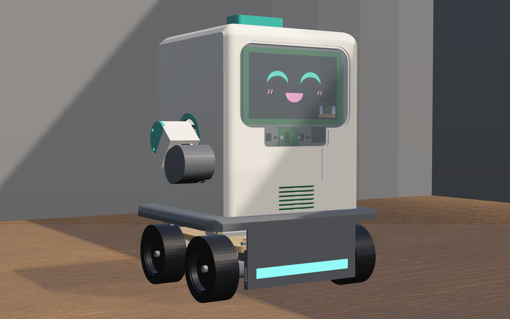
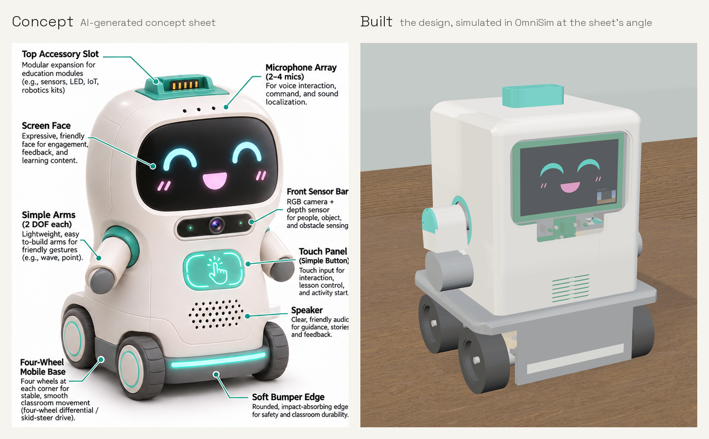
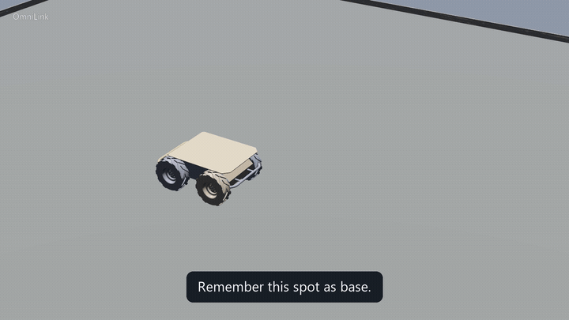
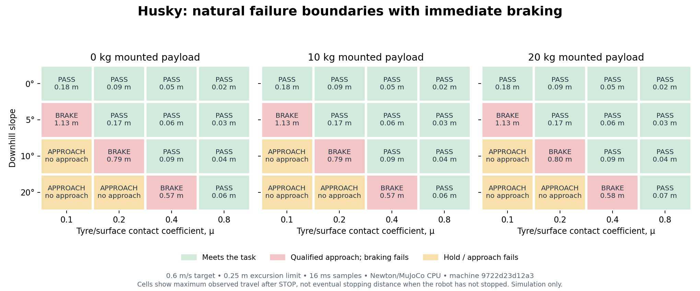
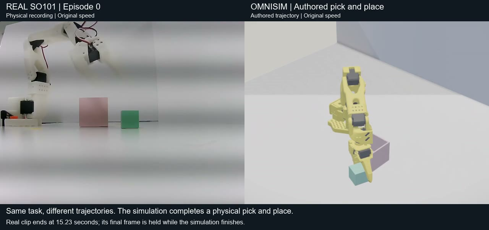
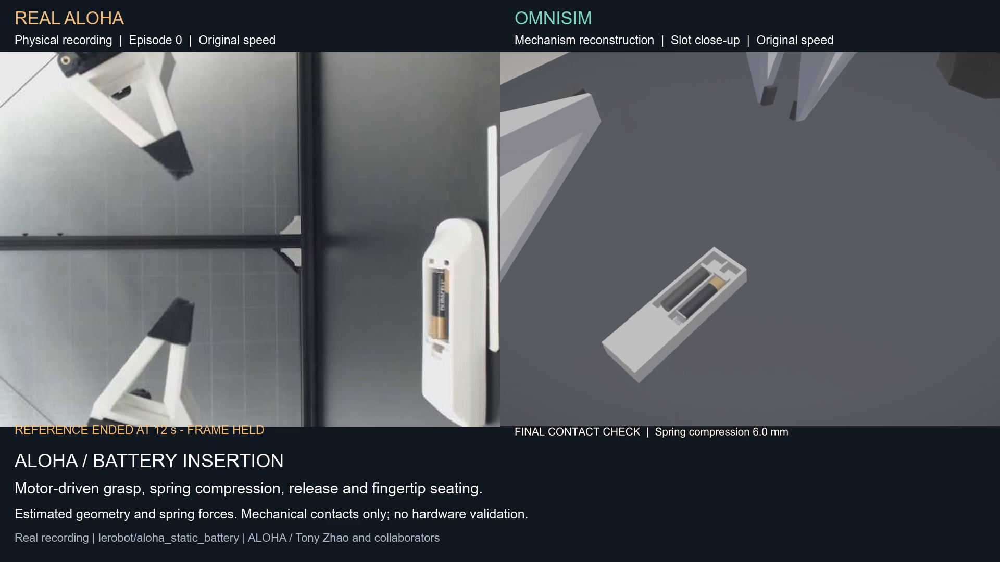

# OmniSim

**An open-source robotics workshop for agents.**

If you're learning robotics, building a robot, or have an idea but don't have access to the
hardware, OmniSim is built for you.

OmniSim is more than a simulator. It's an open-source robotics workshop designed for agentic
development — a place where an agent has everything it needs to work on any robotic system. You
can simulate complete robotic systems with high-fidelity physics, build digital twins, connect
simulation to real robots, and give AI agents a workshop to program, test, and debug your system.

**You can do all of that simply by talking to it.**

## New in v10: OmniSim Manufacturing — from a concept image to a robot you could build

[](docs/guide/manufacturing-concept-to-robot.md)

The SparkRover Mini began as a few AI-generated concept sheets: a friendly classroom robot with arms, a face
and a camera. An AI agent, under human direction, turned it into a design in OmniSim. It corrected the sheets' numbers and wrote down every
decision: no gripper, a plain camera instead of a depth camera, a 2S2P battery for runtime. It then designed
the robot as four subsystems against one skeleton and checked 325 solids for interference. It made every part on
**machine twins** and wired it with 127 routed wires. Finally it assembled the robot on Newton and drove it.

[](docs/guide/manufacturing-concept-to-robot.md)

- **Three machine twins, each built from the real machine's controller config.** A LongMill MK2 CNC router behind
  a virtual GRBL 1.1 controller that any GRBL sender can drive. A Sienci LaserBeam 7 W laser on the same machine.
  A Sovol SV08 printer whose G-code comes from CuraEngine and is planned as Klipper plans it. Material is removed
  or laid where the tool really went, and each part is measured against its drawing. On the CNC twin a pocket's
  walls came out within 0.007 mm of what a perfect machine cuts on the same program.
- **The SparkRover, in the twin's numbers:** 16 of 16 laser and CNC parts cut free. 27 printed parts, all on the
  corrected bead rule: 2 on the full printer twin and 25 in the engine-free *ideal* mode, with their
  full-twin runs on the fixed engine to follow. 53 units assembled in 18 steps with none blocked.
  It drives 0.694 m/s straight on Newton against 0.696 m/s predicted from the motor datasheet at the battery
  model's bus voltage. The conditions, and every open item, are in its
  [report](projects/manufacturing/products/spark_rover/release/REPORT.md).
- **A release pack you could build from.** Its [`release/`](projects/manufacturing/products/spark_rover/release/)
  folder has an SVG drawing and an STL for every made part, the exact laser, CNC and print programs the twins
  ran, the BOM, the wire cut list and a step-by-step assembly guide. The
  [desk robot](projects/manufacturing/products/desk_robot/README.md) has one too.

⚠️ **Simulation only.** No twin has been validated against its real machine, and nothing here has been made on a
real one. A twin print (full physics) and an ideal print (no engine) are different results, and every table says
which it is. Not simulated: the robot's microphones, speaker, touch pads and status ring, and cutting load on acrylic. The
print model's bead rule was corrected in this release; twin prints measured before the fix are labelled so.

**Read the story:** [From concept images to a working robot](docs/guide/manufacturing-concept-to-robot.md) ·
**Make your own:** [design, make and assemble a product](docs/guide/manufacturing-make-your-own-product.md) ·
**The sector:** [projects/manufacturing](projects/manufacturing/README.md)

Before the first stage, run `python -m omnisim manufacturing setup`: it shows what pip will install and asks
first. Then run `python -m omnisim manufacturing doctor`. The slicing stages also need UltiMaker Cura 5, which
setup does not download.

```bash
python -m omnisim manufacturing            # the machines, worlds and products
python -m omnisim manufacturing setup      # the stages' Python packages (pinned, CPython 3.12); asks first
python -m omnisim manufacturing doctor     # per stage: can it run, and what is missing
python -m omnisim run-world projects/samples/demos/worlds/manufacturing/spark_rover_drive_test.omniworld
```

## Give it an instruction. See it move.

[](docs/media/omnilink-husky/omnilink-husky-live-ai.mp4)

*One Husky. One arena. Live AI instructions, follow-up questions, and a return
to base. [Watch the full 100-second video](docs/media/omnilink-husky/omnilink-husky-live-ai.mp4)
· [Run this demo](docs/guide/omnilink-chat-demos.md). Silent native OmniSim footage;
waiting removed and motion time-compressed. The preview shows the opening 32 seconds.*

**OmniSim is the free robotics workshop. [OmniLink](https://www.omnilink-agents.com/)
is the connected AI agent.** OmniLink requires an OmniKey and a model connection,
including on Free; model usage is billed separately.
[Connect your account](https://www.omnilink-agents.com/agents/start).
The recorded result is simulation, not a hardware demonstration.


- **No robot?** Simulate one. [Newton](https://github.com/newton-physics/newton) physics — rigid
  bodies, contacts, cloth, soft bodies, CUDA granular media — 52 demo worlds, and a procedural
  world generator.
- **Already have a robot?** Build its digital twin. Native URDF import, CAD import from STEP, and
  20+ vendor robot packages under [`projects/robots/`](projects/robots/).
- **Want it to reach the real machine?** The same agent tools and the same bridge protocol address
  the simulated robot and the physical one, alongside a [ROS 2 sidecar](packages/omnisim-ros2/)
  speaking the `simulation_interfaces` standard. What is portable is the software above the driver:
  the driver itself is yours to wire, and no policy trained here has been validated on hardware —
  see the [sim-to-real guide](docs/guide/omnilink-sim-to-real.md).
- **Don't know how to program it?** Let an agent help build and debug it. The first-party
  [MCP server](packages/omnisim-mcp/) gives Claude Code and Cursor 46 tools onto a running
  simulation, and when the robot misbehaves the agent can ask what actually happened — every
  contact, every joint limit, every grip, every line your controller printed, on one cursor-paged
  HTTP stream. On the CPU solver (`newtonSolver "mujoco"`, the default) the same scene runs
  bitwise identically across cold launches — measured on contact-rich ten-robot scenes, and
  refuted on the GPU solver — so a failure you can reproduce is a failure you can fix.

The goal is simple: **make robotics accessible to anyone with an idea.** OmniSim is completely free
and open source, Apache-2.0.

Built by agents, for agents: the HTTP harness, the Newton physics integration, the cloth and
soft-body stack, the RL pipeline and the ROS 2 sidecar were written by an AI agent under human
direction. And when the instruments cannot see, they say so instead of guessing: `GET /sim/contacts`
returns its own `completeness` and `empty_set_reasons[]` rather than an empty list that reads as
"nothing touched". Time control is partial: v9 added a held pause and break-on-event, but there are
no watch conditions, no record/replay/diff, and snapshot is a pose teleport rather than a checkpoint. And
Windows has the only prebuilt package: Linux is a source build, macOS is not supported. Those gaps
are itemised in [what OmniSim is worse at](#what-omnisim-is-worse-at).

[**Join the public beta**](BETA.md) · [Builder challenge](BUILDERS.md) · [For research labs](LABS.md) · [Latest release](https://github.com/omnilink-tech/omnisim/releases/latest) ·
[Demos](DEMOS.md) · [Agent entry point](AGENTS.md) · [Protocol](PROTOCOL.md)


> **Public beta:** we are looking for the first ten external developers willing
> to spend 20 minutes installing OmniSim, running one demo, and reporting the
> first confusing or broken step — and, better still, to bring us something that
> misbehaves and find out whether OmniSim can explain it.
> Windows has the first downloadable package;
> Linux is a source build; macOS is not supported.
> [Take the 20-minute challenge →](BETA.md)

---

## Find a robot's limits in simulation

**Test where a robot model stops succeeding.** Sweep downhill slopes, tyre/surface
friction and mounted payloads, measure stopping behavior, and reproduce the
failures in fresh simulations. The assessment saves a report, per-step traces,
native captures for confirmation cases, and the exact test conditions.

```powershell
python -m omnisim assess sweep --robots husky --refine 12 --confirm 2 --workers 2 --out .tmp/husky-assessment
```

The Husky example tests 0–20° downhill slopes, four friction settings and
0/10/20 kg mounted loads at a target 0.6 m/s, with **immediate braking throughout**.
Its stopping requirement is 0.25 m. The report distinguishes braking failures
from inability to reach speed, sliding, and tipping. These are results for a
simulated model and test controller, not hardware validation or manufacturer
ratings. [Run the assessment and inspect the evidence](docs/guide/robot-assessments.md).

For a manufacturer handover, the [US$100 Husky package scope](projects/assessments/packages/husky/SCOPE.md)
defines a 64-episode reference-controller braking assessment, report, raw evidence
and reusable tests with an offline Windows runtime. [Build and verify a delivery](docs/guide/robot-assessments.md#deliver-the-fixed-scope-husky-package).
Production-controller integration and hardware correlation require separate scope.

The [shared assessment package factory](docs/guide/robot-assessment-packages.md)
defines robot-specific $100 braking packages for the seven physical-wheel task
adapters. It selects each model's speed, payload fixtures, requirements and
notices, then requires a qualifying campaign and a checked Windows delivery.
Use `python -m omnisim assess qualify --robot jackal --workers 1 --out <new-directory>` to
start Jackal's profile. Other robot classes require task-specific adapters.

The [Go2 and G1 assessments](docs/guide/legged-assessments.md) add two defined
legged tasks: 17 Go2 walk/stand/walk episodes and 14 G1 standing episodes.
On machine `9722d23d12a3` (Newton/MuJoCo CPU, 16 ms observations, 2026-10-29),
a tighter Go2 handover orientation guard changed a reproduced 15 s request
from a fall at 17.232 s to a completed 32 s task. All 14 candidate runs passed,
including seven prior timings and four prespecified new fractional timings.
G1's selected stance passed 32 s and held-out 48/60 s standing checks.
These are bounded reference-controller simulation results. G1 standing here
has no support harness; this does not establish unassisted humanoid walking.
Reports, native comparison videos and public rerun instructions are on the
[OmniLink service page](https://www.omnilink-agents.com/services/robot-assessments).

The [Husky mixed-surface assessment](docs/guide/husky-mixed-surfaces.md) adds
braking and 90-degree turning on physical rigid friction patches. Its frozen
76-episode study compares 0.6 m/s cruise with a 0.35 m/s mapped-surface cap:
in the shown flat, unloaded μ 0.8→0.04 crossing, braking excursion changes
from 0.458 to 0.156 m and maximum turning-path error from 0.963 to 0.109 m.
Both selected task pairs reproduced in fresh confirmations. The cap costs
throughput; its seven remaining split-surface turning failures are addressed
by a separate 93-episode reference repair. All seven repaired endpoints and
all 27 regression conditions pass; 11/12 new friction/payload combinations pass.
The repair uses a known-map approach, wheel control changes and a lower
0.18 m/s turn target. One prospective input still fails approach-speed
qualification (mu 0.30, 17.5 kg), and remains visible in the report.
Machine `9722d23d12a3`, Newton 1.5.0 / MuJoCo 3.11 CPU, 16 ms,
eight configured substeps, 2026-10-29. These are imposed contact coefficients,
not calibrated real materials or hardware limits. The public source add-on,
complete report and native video are on the service page.

[](tests/assessment/evidence/husky-envelope-20261028/report.html)

**Measured example:** at 5° downhill with a 10 kg mounted load, μ=0.10 produced
1.13 m of travel in the 2.5 s after STOP and the robot was still moving; μ=0.20
met the same requirement with 0.166 m of travel. Both commanded immediate braking.
The 64-case campaign includes 48 grid cases, 12 refinement cases and four fresh
confirmations; the confirmed pass/fail cases reproduced their measured distances
in these runs. Conditions: 0.6 m/s target, 16 ms samples, CPU solver on machine
`9722d23d12a3`. [Conditions, source snapshots and all attempts](tests/assessment/evidence/husky-envelope-20261028/README.md).

The braking adapter supports seven physical wheeled-model configurations:
Husky, Jackal, ROSbot, ROSbot XL, and TurtleBot3 Burger/Waffle/Waffle Pi.
All seven completed the [35 unloaded/loaded coverage cases](tests/assessment/evidence/mobile-payload-coverage-20261028/README.md);
these verify the task path, not each robot's failure envelope.
`python -m omnisim assess robots` lists the full URDF inventory and its task
coverage; Go2 transitions and G1 standing use the separate adapters above.
Other legged tasks, arms and drones require their own assessment adapters.
Windows has the prebuilt package; Linux requires a source build.

## A tested robot mission agent

The [Husky mission agent](projects/services/husky_mission/README.md) turns an
OmniLink request into a bounded physical task: visit station A, then B, then
return to base. Visits require measured arrival and a stop; cancellation and
independent typed Stop interrupt the route. The package includes source,
acceptance tests and raw simulation evidence. An OmniKey and an active model
provider are required for AI requests. This pilot uses a known flat empty arena;
hardware operation and obstacle avoidance are outside its scope.

The frozen suite passed **26/26 valid episodes across 27 attempts**, including
six live AI episodes. One controller startup was invalid and is retained; the
unchanged case passed on rerun. [Watch the demo, inspect the report and download
the public source add-on](https://www.omnilink-agents.com/services/robot-agents).

The [OmniArm 6 assurance pilot](projects/services/arm_assurance/README.md)
adds ordered joint poses, persistent Hold, explicit Resume, Cancel and Stop in
a configured no-payload cell. Its 220 live requests completed 40/40 requested
routes, with no unwanted-motion threshold breaches in 140 designated checks
and 98 sensor-backed step receipts. The full suite passed 19/20 episodes:
one route finished before the sequential cancellation test reached it. Three
separate tests cancelled while the original request was still pending and
passed. These are simulation results on machine `9722d23d12a3`, not a general
safety or hallucination guarantee. [Watch the arm and three-robot crew,
inspect the charts, and download the tests](https://www.omnilink-agents.com/showcase/evidence).

## How OmniLink compares in OmniSim

**In the original study, OmniLink kept the most commitments among seven configurations** in a
blind 30-minute warehouse shift: **89.9%**, versus **47.9–78.8%** for the other
configurations. Every agent used Gemini 3.5 Flash on the same simulated Husky,
with 33 scored checks and three repeats each.

[](https://www.omnilink-agents.com/benchmarks/operations-shift/index.html)

A later retrospective run of **Codex with GPT-6.1 Sol, high reasoning, scored 76.8%**
on the same shift across three repeats, with one check flagged unsafe in
one of three episodes. It used the same full robot tools and instructions, but a
different model and later build; three simulators ran together rather than seven.
Each Codex session was isolated from the test script and previous results.
This is a system comparison, not a fresh blind or model-controlled test.
[Codex conditions and evidence](https://www.omnilink-agents.com/benchmarks/operations-shift/index.html#codex-extension).

A matching retrospective run of **Claude Code with Opus 5.5, high effort, scored 80.8%**
across three repeats, with no check flagged unsafe. It used the same protocol,
machine, engine binary and robot tools as the Codex run. Its episodes ran
closer to real time than Codex's (worst window 0.97× vs 0.15–0.26×), which may
have favoured it. Its scores overlap Codex's, so neither is shown to be better.
The adapter was written by a Claude Code session on the same model.
[Claude Code conditions and downloadable evidence](https://www.omnilink-agents.com/benchmarks/operations-shift/index.html#claude-extension)
· [Repository report](tests/benchmarks/robot_ops/evidence/CLAUDE_SHIFT_V1_RESULTS.md).

**OmniLink also had the lowest estimated model cost in the original study:**
**$0.90 per scored shift**, 32–59% below the six original comparison configurations.
**Codex's and Claude Code's actual costs are unavailable and are excluded from the cost ranking.**
Codex's recorded tokens produce a conditional $0.91-per-shift Standard API pricing
scenario with 98.1% cached input. This does not establish its subscription charge,
API cache-write cost or a cost tie with OmniLink.
Claude Code's own CLI reports an unranked list-price estimate of $1.24 per shift;
it does not establish the actual subscription charge or a comparable API cost.

[](https://www.omnilink-agents.com/benchmarks/operations-shift/index.html#cost)

The cost graph counts all model usage recorded for the three scored shifts,
including failed checks. Original infrastructure errors and the superseded Codex
wave are reported separately in the [cost ledger and pricing conditions](https://www.omnilink-agents.com/benchmarks/operations-shift/index.html#cost).
Subscriptions, hosting, local compute and tax are excluded. Cost estimates are
based on recorded usage, not invoices; interrupted Codex calls may lack final usage.

OmniSim is the simulator for every configuration; this compares tested agent
integrations, not physics engines. One shift, one robot, one Windows laptop
(RTX 3060 Laptop GPU; Newton/MuJoCo physics on CPU). The benchmark, grader and
integrations were built by the OmniLink team. OmniLink led on the preregistered
score, but its equal-tools lead weakens when reply checks are excluded; that
comparison remains unsettled. Seven errored competitor episodes were re-run
under a recorded amendment. Simulation only; no hardware validation.

[Full results, methodology and downloadable evidence](https://www.omnilink-agents.com/benchmarks/operations-shift/index.html)
· [Repository report](tests/benchmarks/robot_ops/evidence/SHIFT_V1_RESULTS.md).
The graph uses the same published results as the OmniLink landing page. OmniKey
and your model-provider key are required; model inference is billed separately.

## Run your first simulation

Three minutes on Windows. About half an hour on Linux, because you build it.

1. **Get OmniSim.**
   - **Windows 10/11** — install the asset from the
     [latest release](https://github.com/omnilink-tech/omnisim/releases/latest)
     (~600 MB). This is the only prebuilt package.
   - **Linux** — Ubuntu 24.04 or 22.04, built from source:
     `bash scripts/install/linux_bootstrap.sh`. Budget 25–45 minutes; most of it
     is the compile. Details: [quickstart](docs/developer/quickstart.md).
     On 22.04 the bootstrap installs Python 3.12 (deadsnakes) and the engine
     embeds it — the system 3.10 cannot run `newton`, and the build refuses to
     link it rather than produce a simulator where nothing moves.
   - **macOS** — not supported. There is no package, no verified build, and
     Newton physics is unverified. Use Windows or Ubuntu 24.04.

2. **Check the install.** Open a terminal in the OmniSim directory:

   ```bash
   python -m omnisim doctor
   ```

   It ends on a VERDICT line, and exits non-zero if the install cannot run —
   most usefully when the Newton runtime is absent, which is not a degraded
   mode but an install where nothing ever falls. On Windows without Python,
   run `omnisim.bat doctor` instead: it uses the interpreter in the package.

3. **See a robot move.**

   ```bash
   python -m omnisim demo
   ```

   This runs the self-contained OmniArm friction-grasp demo. For the Husky
   conversation shown above, follow the [OmniLink setup guide](docs/guide/omnilink-chat-demos.md). `python -m omnisim demos` lists
   all of them (52 as of 2026-09-01), by category — the launcher's `demos.json`
   is the live catalogue.

Then choose the shortest route to your own work:

- **Coding agent or MCP client:** read [AGENTS.md](AGENTS.md). Opening this
  directory in Claude Code registers the first-party
  [OmniSim MCP server](packages/omnisim-mcp/) automatically — the checked-in
  `.mcp.json` does it, with no install. Start the harness it proxies with
  `python -m omnisim harness`. There is also a packaged
  [OmniSim Codex plugin](plugins/omnisim/).
- **ROS 2:** start with the verified
  [`ros2_control` Husky diff-drive example](packages/omnisim-ros2/README.md#tier-3-ros2_control-on-the-husky).
- **Your robot or research task:** use the [URDF/STEP workflows](LABS.md#good-first-pilots),
  or ask OmniLink to port one bounded, measurable pilot.

If any step is confusing or fails, that is exactly what the
[public beta](BETA.md) is designed to capture.

---

## Real recordings and simulation comparisons

Two supporting studies show how real robot tasks can be reconstructed in
OmniSim. **These are authored simulation motions beside real recordings,
not validated transfer to hardware.**

### SO101 · pick and place

[](sim-to-real/so101/videos/real-vs-authored.mp4)

[Watch the 21-second comparison](sim-to-real/so101/videos/real-vs-authored.mp4)
· [Evidence, source attribution and reproduction](sim-to-real/so101/README.md).
The authored simulation picks and places the cube; exact recorded-action replay
still fails with the estimated calibration.

### ALOHA · spring-loaded battery insertion

[](sim-to-real/aloha-battery/videos/real-vs-spring-insertion.mp4)

[Watch the 28-second comparison](sim-to-real/aloha-battery/videos/real-vs-spring-insertion.mp4)
· [Evidence, source attribution and reproduction](sim-to-real/aloha-battery/README.md).
The simulation demonstrates grasping, spring compression and fingertip seating.
Geometry and mechanism parameters are estimates; recorded actions do not reproduce
the insertion. No electrical or physical-hardware validation is claimed.

[Browse both studies](sim-to-real/README.md)
· [Connect the same control surface to a hardware driver](docs/guide/omnilink-sim-to-real.md).

---

## How OmniSim compares

Every OmniSim cell is **measured by us** and is reproducible from this repo. Every row names the
machines that produced it and we never average across them: the §3 throughput rows are **three**
machines, the §3 workload rows and the capability matrix are **two**, and a row that is still one
machine says so in the row. The machines are a **laptop RTX 3060 (6 GB), Ryzen 16-thread, Windows
11** (`9722d23d12a3`), an **RTX A4500 / AMD EPYC 7352, Ubuntu 22.04** (`8ab788c4c833`), and RunPod
**RTX 4000 Ada** (`c72ce5632c81`) and **RTX 4090** (`b5dadd645b1f`). Competitor cells are **their own
published documentation**, dated and linked; we did not measure their engines. Where we lose is in
[its own section](#what-omnisim-is-worse-at).

### 1. Observability, and the agent-native surface it rides on

The first two rows are the debugger; the rest are how an agent reaches it.

|  | **OmniSim** | Gazebo Jetty | Isaac Sim 6.0.1 |
|---|---|---|---|
| Typed runtime events | **10**, with drop counters | — | — |
| Structured load diagnostics | **50+ codes** (open enum; `GET /capabilities` serves the live set) | — | — |
| First-party HTTP/JSON scene API | **38 endpoints** | none | none |
| First-party MCP server | **46 tools**, stdio, zero deps — each one HTTP call to the same harness a human drives | none | **5 tools — docs search; none touch a running sim** |
| Typed external control | 38 harness + 15 capture verbs, **plus ROS 2 `simulation_interfaces` (15 svc + 1 action) and a `ros2_control` `SystemInterface`** | ROS 2 `simulation_interfaces` (18 svc + 1 action) + `ros2_control` | ROS 2 + `ros2_control`, **plus raw Python over TCP :8226** |
| `AGENTS.md` at repo root | **701 lines** | none | **yes, + 25 `SKILL.md` skills** |

That event-type list is not maintained by hand. The simulator regex-scans its own emit call sites and
reports any drift between code and declaration as `undeclared` / `declared_not_emitted` on
`GET /capabilities`
([`event_bus.py`](projects/default/controllers/harness_supervisor/event_bus.py)) — so the row above is
a count of what the code emits, not of what the docs remember. Reproduction is scoped the same way:
on the CPU MuJoCo path (`newtonSolver "mujoco"`, the default) OmniSim reproduces contact-rich
ten-robot scenes bitwise across cold launches on one machine, and across two machines running the
**same binary**; on the GPU `mujoco_warp` path it does not, and that is refuted rather than
unmeasured — 0 of 24 same-config pairs
([determinism-scope.md](docs/benchmarks/determinism-scope.md)). We do not compare that against other
simulators here: determinism only compares like with like, solver against solver
([why](docs/developer/simulator-comparison.md#33-determinism--a-row-worth-having-but-it-must-be-compared-like-with-like)).

### 2. Performance and resources

|  | **OmniSim** | Gazebo Jetty | Isaac Sim 6.0.1 |
|---|---|---|---|
| Minimum GPU | **none — the default solver is CPU** | OpenGL >3.3 | **GeForce RTX 4080** |
| Minimum VRAM | n/a on the CPU path | not published | **16 GB** |
| Datacenter GPUs | fine | fine | **A100 / H100 [unsupported](https://docs.isaacsim.omniverse.nvidia.com/latest/installation/requirements.html)** |
| Installed size | **7.7 MB binary + 647 MB runtime** — Windows beta package published; Linux is source-build | not published | **13.02 GB + 80.17 GB assets ≈ 93 GB** |
| Container image | CUDA **training** image on [GHCR](https://github.com/omnilink-tech/omnisim/pkgs/container/omnisim-train); a CPU **runtime** image ([`docker/`](docker/README.md)) builds and smoke-tests but is **not on the registry yet** | yes | **10.7 GB** |
| GPU physics | **yes** (`mujoco_warp`) | **none**, absent from the roadmap | yes |
| Batched parallel envs | **yes** | process-level only | yes |

### 3. What that hardware actually runs

Every row says which machines produced it, listed separately and never averaged. Throughput:
**three** machines ([campaign](docs/benchmarks/omnibench-multimachine-2026-08-17.md), 2026-08-17):

| GPU | GPU-batched physics @4096 | Full in-engine PPO @4096 | overhead vs raw MuJoCo-Warp |
|---|---|---|---|
| **RTX 3060 Laptop, 6 GB** (`9722d23d12a3`) | **165,369 env-steps/s** | **98,136 env-steps/s** | 1.27× @256 · 1.39× @4096 |
| RTX 4000 Ada, 20 GB (`c72ce5632c81`) | 280,820 | 201,850 | 1.26× @256 · 1.44× @4096 |
| RTX 4090, 24 GB (`b5dadd645b1f`) | 535,377 | 499,734 | 1.24× @256 · 1.40× @4096 |

Everything else, with its coverage stated per row
([campaign](docs/benchmarks/lane4-multimachine-2026-08-17.md), 2026-08-17):

| Workload | Measured | measured on |
|---|---|---|
| Rigid bodies at real time, CPU solver | **200 bodies @ 1.45×** (3060 laptop, Ryzen) and **@ 1.35×** (RTX A4500 pod, EPYC 7352) — ceiling not reached on either | **2 machines** |
| Overhead vs raw MuJoCo-Warp, identical model, both CUDA-graphed | **1.24–1.44×**, and the ratio tracks batch size, not GPU | **3 machines** |
| With **no CUDA device visible to the process** | trajectory **bit-identical** to the GPU-visible run, on both | **2 machines** |
| Cloth, 289-particle drape, as shipped | **2.85 ms/step (2.81×)** laptop · **2.36 ms/step (3.39×)** A4500 | **2 machines** |
| Cloth, same drape at 2 VBD iterations | 1.28 ms/step (6.2×) laptop · 0.60 ms/step (13.2×) A4500 | **2 machines** |
| Cloth **forced onto the CPU** | 51.9 ms/step — **0.15× real time**, so deformables are a GPU feature | ⚠ **1 machine** (laptop) |
| Silent constraint-buffer overflow, `mujoco_warp` | **16 driven rovers exceed the 256-row default** (peak 336 / 328) with a clean log and exit 0 | **2 machines** |
| Unit | 1 env-step = one 16 ms control step = 8 physics substeps | — |
| RAM / VRAM footprint | **not measured — we publish no figure** | — |

### 4. Beyond rigid bodies — cloth, soft bodies, cables

|  | **OmniSim** | Gazebo Jetty | Isaac Sim 6.0 |
|---|---|---|---|
| Cloth | **yes** — Newton VBD; a T-shirt grasp measured against a negative control | **none** | particle cloth **removed → error stubs**; replacement is **beta** |
| FEM soft bodies | **yes** — tet-`SoftBody`, two-way soft→rigid coupling measured | **none** exposed | new schema (old removed) |
| Cables / rods | Newton ships it; **no OmniSim node yet** | none | Newton VBD only, not PhysX |
| Granular | CUDA kernel, 100k particles @ 4.50 ms/step — **robot↔particle coupling currently dead** | none | GPU PBD; **no CPU support** |
| Particles | via cloth / soft / granular | **visual + lidar scattering only** | GPU PBD; schema *"not finalized"* |
| Fluids | **none** (removed with ODE) | analytic drag only | PBD position-based |

The grasp numbers behind that first row — tracking error **−1.50 mm** on a 616-particle T-shirt
against **−173.06 mm** for a negative control whose jaws never close, corroborated by a second
instrument, plus the hem-edge target that **misses** and is reported as a miss — are in
[cloth-simulation.md](docs/developer/cloth-simulation.md), with the three disclosures that travel
with them: the fabric is **pinned**, so these are tracking and not load-bearing numbers; self-contact
must be off to grasp and on to drape; and the composed **fold** is not demonstrated.

### 5. Newton maturity

|  | **OmniSim** | Isaac Sim 6.0.1 | Isaac Lab |
|---|---|---|---|
| Newton version | **1.5.0** | **1.2.1** | 3.0 beta |
| Solvers driven | **2** (MuJoCo + VBD) | **1 of 8** (MJWarp) | primarily MJWarp |
| Status | **only backend, shipping** | *"experimental"* | **beta since 2026-03-17, no GA** |

### 6. Licence

|  | Engine licence | Runtime restrictions |
|---|---|---|
| **OmniSim** | **Apache-2.0** | none |
| Gazebo | Apache-2.0 | none |
| Isaac Lab | BSD-3-Clause | inherits Isaac Sim's when used with it |
| Isaac Sim | Apache-2.0 *source only* | NVIDIA ASML: **no redistribution, no derivative works**, use confined to *"systems with NVIDIA GPUs"* |

Caveats, sources and the claim-by-claim comparison with every entry marked verified / unaudited /
vendor-claim: [docs/developer/simulator-comparison.md](docs/developer/simulator-comparison.md).

## What OmniSim is worse at

- **Command checks are not collision avoidance or a safety certification.** Direct
  simulator controls have different protections from the connected chat path; see
  [actuation coverage](packages/omnisim-bridges/GATE_COVERAGE.md). A successful Husky
  recording does not establish safe unattended operation or equivalent performance
  on every robot class.
- **Repeated motion can drift.** The earlier square-loop experiment accumulated
  position error. A short successful return to base does not establish reliable
  operation over a shift without localisation.
- **Time control is partial.** Since v9 a client can hold the engine across calls (`POST /sim/pause`,
  leased: 30 s by default, 300 s cap, so a dead client cannot freeze the sim) and arm a breakpoint on an
  event (`POST /sim/break`); `POST /sim/step` then single-steps and stops early on a break. Detection is
  never sub-step, and there are two latency regimes: held plus `/sim/step` costs at most one basic step
  of engine time, but free-running costs one supervisor tick, which has measured 8 ms to ~600 ms of
  engine time depending on load — so pause first, then step. Still missing: **watch conditions,
  record, replay and run-diff**. And `POST /sim/snapshot` is **not a checkpoint**: it saves poses and
  joint angles only. Velocity is never captured (`OmSolid::saveHiddenFieldValues()` is an empty
  function) and solver state is never touched, so restore teleports bodies to the saved poses while
  they keep their live Newton velocities, and does not rewind the clock. Identical forward evolution
  from a restore is not achievable, and we do not claim it.
- **Light mode is the default, and it silences 5 of the 11 event types** (`contact.*`, `grip.*`,
  `joint.limit_hit`); a breakpoint armed on a silenced type is refused rather than accepted and never
  fired. Load the world with `{"light": false}` for a debugging session; `/sim/contacts` answers either
  way. Separately, controller logs and physics events **cannot be put on one
  timeline**: log events carry a wall clock (`t_wall`), supervisor events carry sim milliseconds
  (`t_sim_ms`), and `seq` collides across the two sides.
- **Sensors are not readable through the debug surface.** `GET /robot/<def>/sensor/<name>` is a
  deliberate 501 — cameras, lidar and IMUs are read by the controller that owns them, not by the
  instrument. Joints, contacts, grips, devices and bounds are readable; sensor samples are not.
- **Fault injection is structural impact damage only.** No sensor dropout, no encoder drift, no
  actuator degradation, no injected latency, no thermal derating. It binds to a robot named `husky`
  by default and idles silently otherwise, and its `WHEEL_TORQUE_SCALE` is written into `customData`
  for a cooperating controller to honour — **the motor is never touched.**
- **A green `run-headless` is a log verdict, not a physics verdict.** A hologram floor lets a body
  reach z = −69 km and still PASS. Add `--duration N --fail-on-runaway` when the claim is about
  physics.
- **ROS 2 support is new and incomplete.** OmniSim implements the ROS 2
  [`simulation_interfaces`](packages/omnisim-ros2/) standard plus `/clock`, `/tf`, `JointState`,
  `/odom`, `cmd_vel`, sensor topics (`Imu`, `LaserScan`, GPS) and a **`ros2_control`
  `SystemInterface`** — but that last one is verified for **velocity-commanded bases only**
  (`diff_drive_controller` on the Husky). **MoveIt is still out of reach**, because OmniSim's arm
  bridge treats a joint command as a goal and answers `409 busy` to a setpoint arriving while the
  previous one is still interpolating — a trajectory would land in pieces. **Nav2 now runs
  end-to-end on the Husky for planning and goal execution**, but the verified case uses
  ground-truth odometry and is not a SLAM, AMCL, or obstacle-avoidance benchmark. OmniSim is not in
  the `ros2_control` simulator registry. Sensor
  coverage is partial by measurement, not by omission: OmniSim's `Gyro` and `Accelerometer` produce
  no usable data, so `Imu` ships a real orientation and declares those two components absent, and no
  robot in the tree has a camera. For a lab whose stack *is* ROS 2 end to end, Gazebo remains better
  integrated.
- **Not photoreal.** Isaac Sim's RTX renderer is a different class. Ours is wgpu-native (Vulkan / D3D12 / Metal): a real-time raster stack whose global illumination is *baked* — an off-frame path trace into an irradiance probe volume, not per-frame ray tracing.
- **Sim-to-real is unproven** — zero physical-robot transfer.
- **No free-standing authored humanoid walk** — authored G1 walking demos use a weight-bearing balance harness. The separate standing assessment uses physical foot support without that harness.
  Quadrupeds carry none.
- **Newton is young and we removed our fallback.** macOS is untested, so it has no verified physics.
- **Single-GPU training only.** No multi-GPU or multi-node; Isaac Lab publishes a 16-GPU ladder.
  Our figures are one GPU, and every number above says which one.
- **95.7% of measured capabilities work** (51 probes as of 2026-09-01 round 3 -- eight rows flipped to works in one day, measured: IMU carrier, propeller inflow, ball probe, limit-less servo promotion, cloth/FEM/granular particle readback, connector weld, runtime deletion via rebuild; the
  45-probe set as it stood on 2026-08-17 also ran on a **second machine** — 43 of 45 verdicts
  agreed, and both disagreements are attributed in the
  [campaign](docs/benchmarks/lane4-multimachine-2026-08-17.md), neither to the hardware).
  Restitution is unimplemented, and runtime scene mutation is non-physical in both directions *by
  default*: deleted nodes keep colliding, and spawned nodes are never registered with the solver at
  all (since 2026-09-01 an opt-in mid-run physics rebuild — `POST /sim/rebuild_physics`, 97–267 ms
  measured — fixes both, refused on deformable worlds and dropping engaged welds).
  Compound colliders drop all but the first child by default. A motorised `BallJoint` was measured
  not to actuate, but a 2026-09-01 probe review found that measurement could not have detected
  actuation — unproven either way pending re-measurement (its `Hinge2Joint` sibling does actuate).
  [Capability matrix](docs/benchmarks/lane4-capability-matrix.md) · [CHANGELOG](CHANGELOG.md).
- **A `mujoco_warp` scene silently drops constraint rows past 256.** Measured on both machines:
  16 driven four-wheeled rovers peak at 336 and 328 rows against a cap that does not grow, with a
  clean log and exit code 0. Raise `WorldInfo.newtonNjmax` before you build a fleet.
- **Smaller ecosystem** than Gazebo — fewer robots, fewer worlds, no package index.

---

## Get started

The three-minute path above is the fastest start. Contributors who want a
source build can clone it, open the folder in a coding agent, and ask:

```text
Set up OmniSim from this fresh clone — install whatever the toolchain needs, build it,
and then launch the warehouse Husky demo so I can watch it.
```

The agent follows [AGENTS.md](AGENTS.md) (auto-loaded) and the
[quickstart](docs/developer/quickstart.md). First build is 5–25 minutes. By hand instead:
`build_omni.bat` on Windows, `bash scripts/install/linux_bootstrap.sh` on Linux.

**Then run `python -m omnisim doctor`** — it reports the ground truth about your clone. ⚠️ Newton is
the only backend, so a build without its runtime has **no physics at all** and otherwise fails
quietly.

| | Windows 10/11 | Linux | macOS |
|---|---|---|---|
| Build from source | ✅ documented | ✅ scripted | ⚠️ untested |
| Simulator, URDF import, harness, capture | ✅ | ✅ verified | ⚠️ untested |
| **Newton physics** (the only physics) | ✅ CPU default; GPU needs CUDA | ✅ wheels in the **system** `python3` | ⚠️ **untested — no fallback exists** |
| RL training + locomotion demos | ✅ | ✅ | ❌ |

## What you can ask for

Find out what happened:

```text
"The gripper drops the box when it starts 2 cm left of centre. Run both placements and tell me what differs."
"Which joints hit their limits during that run, and at what sim time?"
"Did the fork and the pallet ever actually touch? Show me the contact set, not a screenshot."
"Why isn't the camera seeing the red cylinder?"
"Run this world twice on the CPU solver and tell me whether the two runs are bitwise identical."
```

Build the thing you need to debug:

```text
"Launch the warehouse demo."
"Generate a Mars world with a 5-Husky fleet and run it headless for 30 seconds."
"Wire a Jackal on a flat platform, expose it on HTTP, and drive it forward 2 m."
```

For the first kind, the agent loads the world with `{"light": false}`, steps it, and reads
`/sim/events`, `/sim/contacts` and `/robot/<def>/joints` — the same HTTP surface you can `curl`
yourself ([endpoints](docs/developer/harness-endpoint-reference.md) ·
[protocol](PROTOCOL.md#7-world-harness)). For the second, it builds the world, edits controllers,
runs the simulator, and verifies its own work through the
[validation harness](scripts/harness/). For runtime control of robots in a live scene, point
[OmniLink agents](https://www.omnilink-agents.com) at the per-robot HTTP bridges
([protocol](PROTOCOL.md)). The chat demos — right-click a robot, type `drive forward 1 m` —
are one of those bridges with a panel on the front ([guide](docs/guide/omnilink-chat-demos.md)).

OmniLink requires an OmniKey and a connected model. Missing setup or model
errors do not switch chat into a basic-command fallback. The robot's direct
Stop control remains independent of the model. See the
[v9 release preview](docs/RELEASE_NOTES_v9.md) for the current scope.

These controls are not a safety certification or a guarantee of collision-free
operation. [Actuation coverage](packages/omnisim-bridges/GATE_COVERAGE.md) documents
the limits of the shipped interfaces.

## Robots

| Brand | Models |
|---|---|
| **OmniSim** | OmniArm 6 cobot · OmniArm 7 cobot · OmniTug 500 warehouse tug |
| **Unitree** | Go2 · B2 quadrupeds · G1 · H1 humanoids |
| **Deep Robotics** | Lite3 · X30 quadrupeds · M20 · M20S · M20 + Piper wheeled-legged · DR02 Standard · DR02 Pro humanoids |
| **OmniLink** | OmniQuad quadruped |
| **Clearpath** | Husky · Jackal |
| **Universal Robots** | UR3e · UR5e · UR10e |
| **Husarion** | Rosbot · Rosbot XL |
| **Robotis** | TurtleBot3 |
| **DJI** | Mavic 2 Pro |

Per-robot status is in [DEMOS.md](DEMOS.md). One caveat on OmniSim's own reference robots:
**OmniTug 500** is a visual-only prop with no collider, so it is positioned kinematically and does
not participate in contact. **OmniArm 6** and **OmniArm 7** are fully simulated, and OmniArm 6 is
verified holding pose under gravity.

## Teaching robots to move

Legged policies are made by **Shadowing** — train against a reference trajectory verified feasible
*before* learning starts, in-engine, so train and deploy share one solver. Fifteen skills ship across
G1, H1, Go2 and OmniQuad; **BATON** composes them into sequences.

```bash
python -m omnisim policy list                  # the catalogue
python -m omnisim policy sequence box_delivery # run a BATON demo
```

⚠️ **Our humanoid demos run on a weight-bearing balance harness and are not free-standing walks.**
Unitree's own policies re-hosted unchanged in OmniSim *do* walk free-standing, so the engine carries
it — training a policy that does is the open problem.

[Shadowing](docs/developer/shadowing.md) · [Skill Library](docs/developer/skill-library.md) ·
[canonical RL status](docs/developer/rl-current-state.md)

## Docs

| Audience | Start with |
|---|---|
| Installing it (per platform, prerequisites) | [Installation procedure](docs/guide/installation-procedure.md) · [System requirements](docs/guide/system-requirements.md) |
| AI coding agent in this repo | [AGENTS.md](AGENTS.md) |
| Debugging a controller, investigating a failure | [Harness endpoints](docs/developer/harness-endpoint-reference.md) · [agent first moves](docs/developer/agents-first-moves.md#debug-a-controller) · [PROTOCOL.md §7](PROTOCOL.md#7-world-harness) |
| Picking a demo | [DEMOS.md](DEMOS.md) |
| Making a product on machine twins | [Concept to robot](docs/guide/manufacturing-concept-to-robot.md) · [Make your own product](docs/guide/manufacturing-make-your-own-product.md) · [projects/manufacturing](projects/manufacturing/README.md) |
| First-time human contributor | [Developer Quickstart](docs/developer/quickstart.md) |
| Engine developer | [docs/developer/](docs/developer/) |
| World author | [Simulation Authoring for Coding Agents](docs/developer/simulation-authoring-for-coding-agents.md) |
| Driving OmniSim from outside | [PROTOCOL.md](PROTOCOL.md) |
| ROS 2 user | [packages/omnisim-ros2/](packages/omnisim-ros2/) · [the ROS 2 story](docs/developer/ros2-integration.md) |
| Benchmarks and physics claims | [docs/benchmarks/physics-comparison.md](docs/benchmarks/physics-comparison.md) · [simulator comparison](docs/developer/simulator-comparison.md) |
| Video and 4K capture | [scripts/capture/README.md](scripts/capture/README.md) |
| Contributing | [CONTRIBUTING.md](CONTRIBUTING.md) |

## Licence · Brand · Bugs · Funding

**Apache 2.0** ([LICENSE](LICENSE) · [NOTICE](NOTICE)). The OmniSim name and orb mark are OmniLink
trademarks ([TRADEMARKS.md](TRADEMARKS.md)) — open code, protected brand: fork and ship, but rename a
modified fork. Bugs go to [GitHub Issues](../../issues/new/choose); sponsorship funds the engine work
([Sponsor](https://github.com/sponsors/omnilink-tech) · [SPONSORS.md](SPONSORS.md)).

### Repository provenance

This public repository is a curated release mirror. Its visible commit graph is
the history of the published mirror, not the complete private development
history, so commit count and first-public-commit dates should not be used as a
measure of total engineering work. For auditable public provenance, use the
tagged [releases](https://github.com/omnilink-tech/omnisim/releases),
[CHANGELOG](CHANGELOG.md), source commit recorded by `python -m omnisim doctor`,
and the binary/world hashes carried by the benchmark artifacts.

### Attribution

Built on [Webots](https://github.com/cyberbotics/webots) (Cyberbotics Ltd., open-sourced under
Apache 2.0 in 2018). Upstream copyright on derived files is preserved; files retaining Cyberbotics
headers remain © Cyberbotics. OmniSim is an independent fork, not affiliated with or endorsed by
Cyberbotics. See [NOTICE](NOTICE) for the full derivation.
