# From concept images to a working robot

This is the story of one small robot, the **SparkRover Mini**. It began as a few concept
sheets made with an AI image tool. It ended as a design that OmniSim's machine twins made
part by part, that was wired and assembled on Newton, and that drives. Every number below
comes from a file in the repository, and the file is named next to it.

If you have an idea for a robot and no lab, this page is for you. It shows what an agent
can do with that idea in OmniSim, and where the work still stops.

> ⚠️ **Simulation only.** No part of this robot has been made on a real machine, and no
> machine twin has been validated against its real machine. Every measured number here is
> the twin's, and its conditions are given with it.

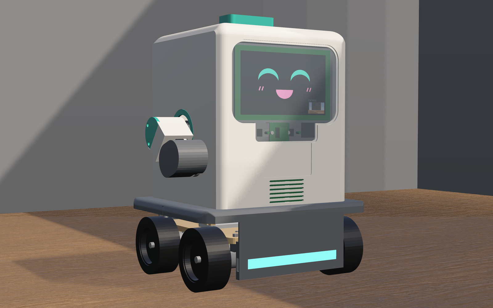

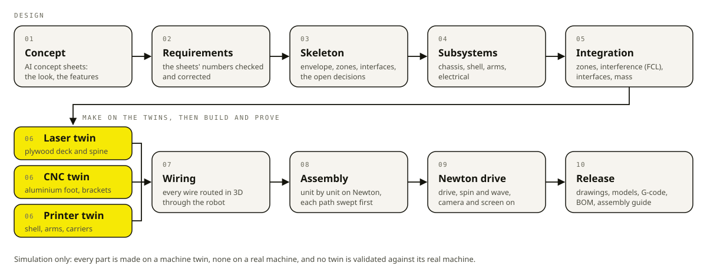

The design lives in
[`projects/manufacturing/products/spark_rover/`](../../projects/manufacturing/products/spark_rover/README.md).
Its generated results are in
[`release/REPORT.md`](../../projects/manufacturing/products/spark_rover/release/REPORT.md).

## 1. Two concepts

The first concept was **EduBuddy 320**: a 320 mm classroom robot on two driven wheels and
a caster. It had two 3-DOF arms (shoulder yaw, elbow pitch, wrist roll) ending in grippers,
and an RGB depth camera. Its sheets give 320 × 180 × 145 mm and a 2.0–2.5 kg target.

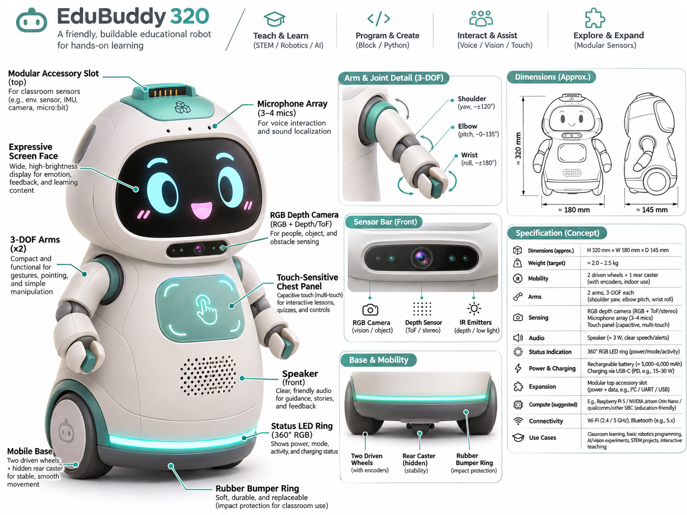

The second concept, the **SparkRover Mini**, is a simplified version. It is smaller and has
four driven wheels, two 2-DOF arms and no wrist. Its own sheets ask for a "low part count".

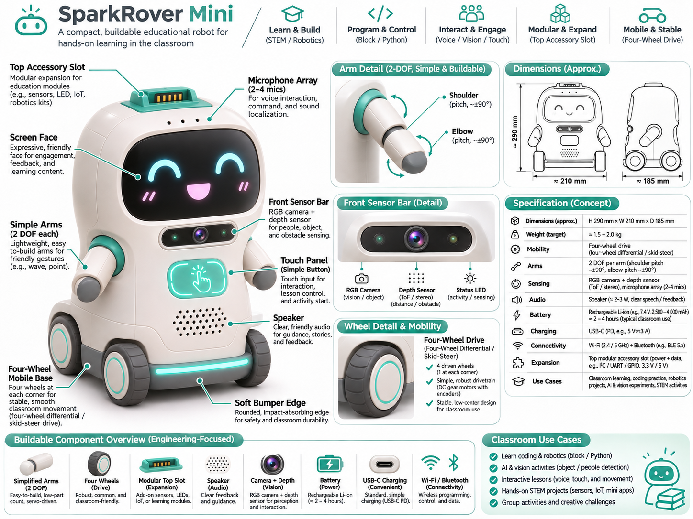

On top of the simplified sheet, the owner made three decisions. `skeleton.py` records
them in `DECISIONS`:

- **No gripper.** "The arms wave, point and gesture; the sheet's 'carry light objects' is
  dropped."
- **A normal camera.** "A plain RGB camera (no depth / ToF)". The simplified sheets still
  drew a depth sensor. The design has none.
- **A 2S2P battery, for battery life.** Four 18650 cells, two in series and two in
  parallel. The decision gives the reason: "2S1P gave ~1.4 h of classroom use against the
  sheets' 2-4 h; 2S2P ~2.8 h for ~95 g more."

## 2. Reading a concept critically

A concept sheet is a picture with numbers on it. Some of those numbers conflict with each
other, and some cannot all be met at once. The first job was to decide each one, once, in
the skeleton. The table compares each sheet value with what was designed.

| | Concept sheet | Designed | Why |
|---|---|---|---|
| Height × width × depth | ≈ 290 × 210 × 185 mm | 290 × 210 × 185 mm | All three sheets agree, so the envelope keeps them (`skeleton.py`) |
| Wheel diameter | 55–60 mm (side sheet), 62–65 mm (front sheet) | 65 mm | The sheets disagree. 65 mm clears thresholds and cables better and is a stock size (`skeleton.py`) |
| Track, ground clearance | 170 mm, ≈ 15 mm | 170 mm, 15 mm | Kept (`skeleton.py`) |
| Weight | ≈ 1.5–2.0 kg | **2397.8 g**, under a 2400 g ceiling | The sheets' figure was a guess. The owner chose runtime over mass (`skeleton.py`, `release/REPORT.md`) |
| Battery | 7.4 V, 2,500–4,000 mAh, "≈ 2–4 hours" | 2S2P Molicel P28A, ~5600 mAh. The battery model gives **2.68 h** on the classroom mix (4.60 h idle, 1.40 h driving) | Computed by a model of the pack built from the cell's data sheet, not taken from the concept sheet (`battery.py`, README) |
| Camera | RGB camera + depth sensor (ToF / stereo) | Camera Module 3: RGB only, 66° horizontal field of view | The depth sensor was dropped (`DECISIONS`) |
| Arms | 2 DOF, shoulder pitch ≈ ±90°, elbow pitch ≈ ±90°; "carry light objects" | Shoulder −70° to 90°, elbow −90° to 90°, no gripper | An arm hanging straight down would strike the lower body, so the shoulder's range keeps the swept arm in its zone (`skeleton.py`, `arms.py` check) |
| Soft bumper | 8 mm soft edge | 6.5 mm TPU | Only 6.5 mm fits between the base and the envelope (`skeleton.py`) |
| Charging | USB-C PD, 5 V 3 A | USB-C at 5 V through a 15 W boost charger, not PD | `DECISIONS` |
| Shell | moulded (the EduBuddy sheet says injection moulding) | printed PETG sections | Injection moulding has no twin. The SV08 printer does (`DECISIONS`) |
| Microphones | 2–4 | two I2S mics | They are designed in but not simulated: OmniSim has no microphone device (README) |

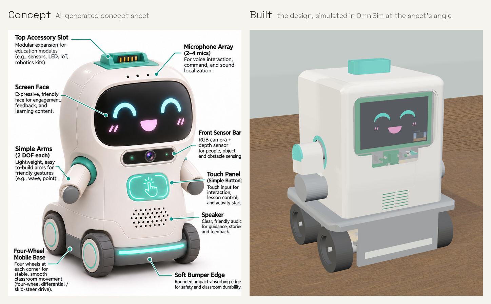

## 3. One skeleton, four subsystems

[`skeleton.py`](../../projects/manufacturing/products/spark_rover/skeleton.py) is the
contract. It fixes the envelope and the robot's frame, a zone of space for each subsystem,
and every interface between subsystems: the shell's eight mounts and the shoulder bolts.
Four agents then each designed one subsystem, on its own, inside its zones and to those
interfaces. The four subsystems are the **shell**, the **chassis**, the **arms** and the
**electrical** system. Each module provides its parts, its closed solids, its machine files
and its own design rules.

Each agent also pushed back on the contract where it had to. The chassis agent moved the
base zone's edge from |y| 70 to 67 mm so the gearmotor's face screws fit. The head zone was
widened from ±60 to ±76 mm so a 5-inch panel fits.

[`integrate.py`](../../projects/manufacturing/products/spark_rover/integrate.py) then joins
the four with exact geometry. It checks every solid against every other with FCL, checks
each subsystem against its zones, checks the interfaces from both sides and adds up the
mass. Today it reports **325 solids, 0 interfering, 0 outside their zones** and 45
interfaces with none missing a side (`release/REPORT.md`).

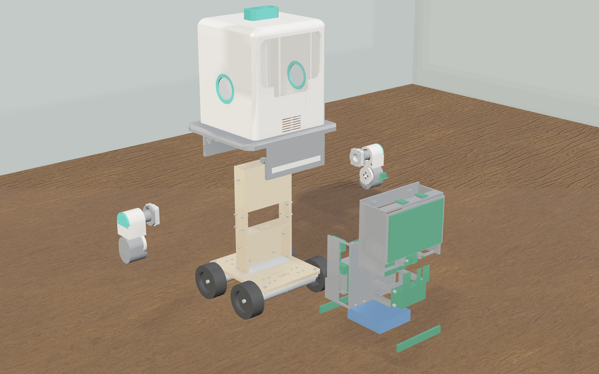

### What integration caught

Some defects exist only where two subsystems meet. Exact geometry is what found these:

- **The motor build order.** Fitting the brackets first and the motors after cannot be
  built. The second motor on an axle has no path past the first, because the encoders sit
  1 mm apart. Each gearmotor now goes into its bracket on the bench first (`assemble.py`).
- **The shell halves were blocked by the bay carrier.** Each upper shell half slides on
  sideways, and its rear-hatch insert bosses sweep through the bay. The carrier's wings
  stood in that path: an FCL sweep hit them 4.5–17 mm out (`electrical.py`). The carrier
  was redrawn.
- **Carriers with no holes.** The first electronics carriers were "solid boxes with no
  screw or insert holes". All three were revised on 2026-11-04 (`release/REPORT.md`).
- **The 100,000-contact cap.** One FCL manager across all the solids keeps at most 100,000
  contacts and silently drops the pairs past that limit. At 259 solids it found 110,997
  contacts and lost two real interferences. `integrate.py` now checks pair by pair.
- **B3 and TP2.** The accessory board B3 was drawn 2.5 mm into the top socket's floor. The
  touch pad TP2 straddled the shell's seam, 1.27 mm into the seam wedge. Both were moved
  (`electrical.py`).
- **The battery's centre of mass.** The 200 g pack's mass sat at its lead exit,
  (−30, −36, 45) mm, instead of at the centre of its volume. It was moved to the centre
  (`robot.py`).

## 4. Made on the machine twins

Every made part was run from its own machine file on the twin of the machine that would
make it, except that most printed parts' current results come from the ideal mode (below).
The engine's own record of the material was then measured against the drawing.

### Laser and CNC

The LongMill MK2 twin cut the plywood with its Sienci LaserBeam 7 W and milled the
aluminium and acrylic with its router. **All 16 of 16 laser and CNC parts cut free**, with
every hole cut (`release/REPORT.md`). The set is **266.5 min** of machine time. The engine
took 62.2 min of wall time for it, over three sessions with two engines at a time, and that
time includes the runs that were stopped or redone (`release/make/made.json`).
On their own, the shoulder brackets took **54.0 min** of machine time in 19.9 min of wall
time (`release/make/MAKE.md`).

Measured against the drawings:

- The lower deck came out 170.15 × 140.15 mm against 170 × 140 drawn. Its ⌀3.40 mm holes
  measure 3.27 mm at the bottom face, because the laser's kerf is a V.
- The milled spine foot's ⌀3.397 mm holes came out at 3.396 mm.

One finding changed the recipe. **6 mm plywood needs 6 passes, not Sienci's 5.** At 5
passes every 6 mm part stayed joined to its sheet by a web of 0.16–0.20 mm. At 6 passes,
every one cut free with all its holes (`release/make/MAKE.md`, `chassis.LASER`).

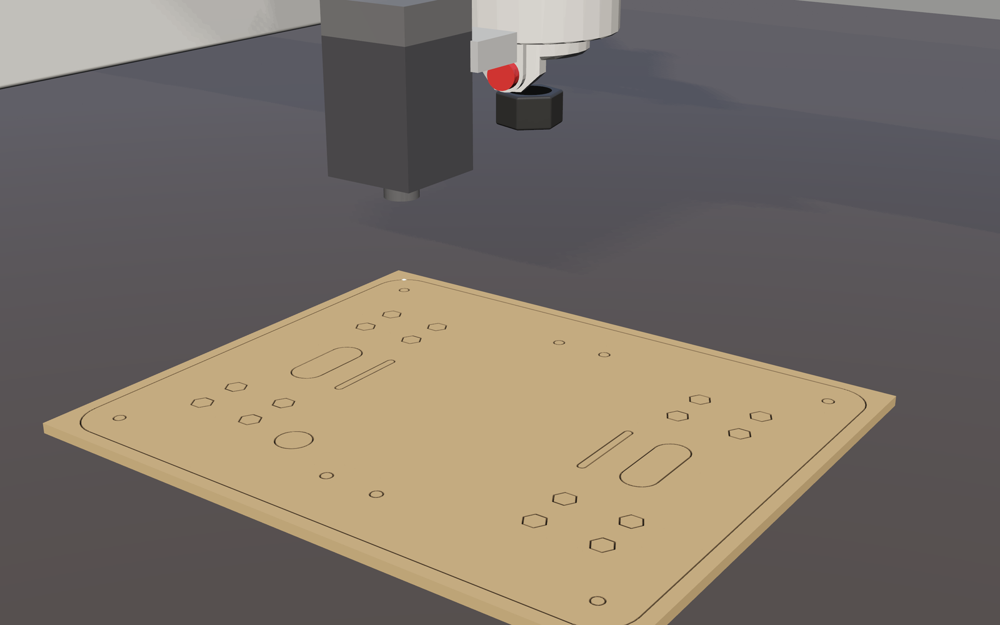

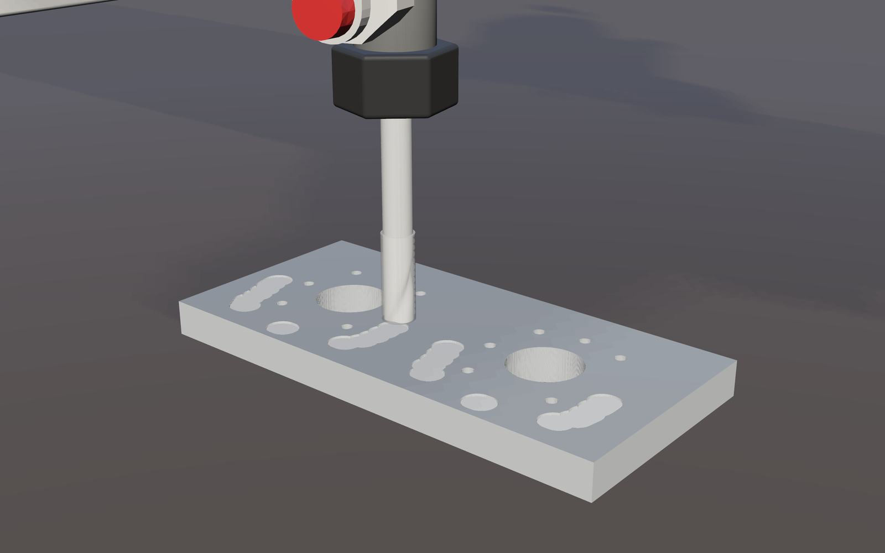

### Printing

The Sovol SV08 printed **all 27 printed parts, on the fixed bead rule: 2 on the full twin
and 25 in ideal mode**. The two on the twin are the bay carrier and the cooler duct, plate
rev02. The 25 parts' full-twin runs on the fixed engine follow in a later 10.0.x
(`release/REPORT.md`; the plates are in `release/make/print/PRINT.md`). The two modes are
different things:

- **Twin** mode is full physics. The SV08's axes run on Newton, and the engine lays beads
  where the nozzle actually is.
- **Ideal** mode runs the same Klipper plan and hotend with no engine, and puts the nozzle
  exactly where it was commanded.

An ideal result is not a twin result. The table below says which mode each figure comes
from. All of them are on the fixed bead rule.

| Plate | Mode | Printer time | Wall time | Speed |
|---|---|---|---|---|
| rev02 (the bay carrier and the cooler duct) | twin | 2:34:44 | 3:09:46 | 0.81× real time |
| rev02 (the same) | ideal | 2:34:44 | 0:00:26 | 356× |
| plate01 (two shell sections, one arm link) | ideal | 4:40:19 | 0:00:29 | 580× |

On the twin, the bay carrier printed 113.45 mm tall against 113.5 drawn. Its outer surface
sits within −0.007 to +0.067 mm of the drawing (5th to 95th percentile over its layers). In
ideal mode, the upper left shell section printed 82.05 mm against 82.0 drawn, within
−0.045 to +0.047 mm. The printed parts weigh **587.6 g** against 756.4 g designed. The
design took each part's mass from its solid volume, but the slicer lays walls and infill
(`release/REPORT.md`).

This work also found a fault in the printer twin's bead model, fixed it and proved the fix
(section 9 explains it). On the same G-code in ideal mode, the nozzle crashes on plates
01, 02 and 06 and on the bumpers' plate went from 116, 96, 152 and 11 to 0, with the same
grams laid. The twin runs made before the fix are kept for comparison, measured before the
bead fix and labelled so in PRINT.md. They are not current results.

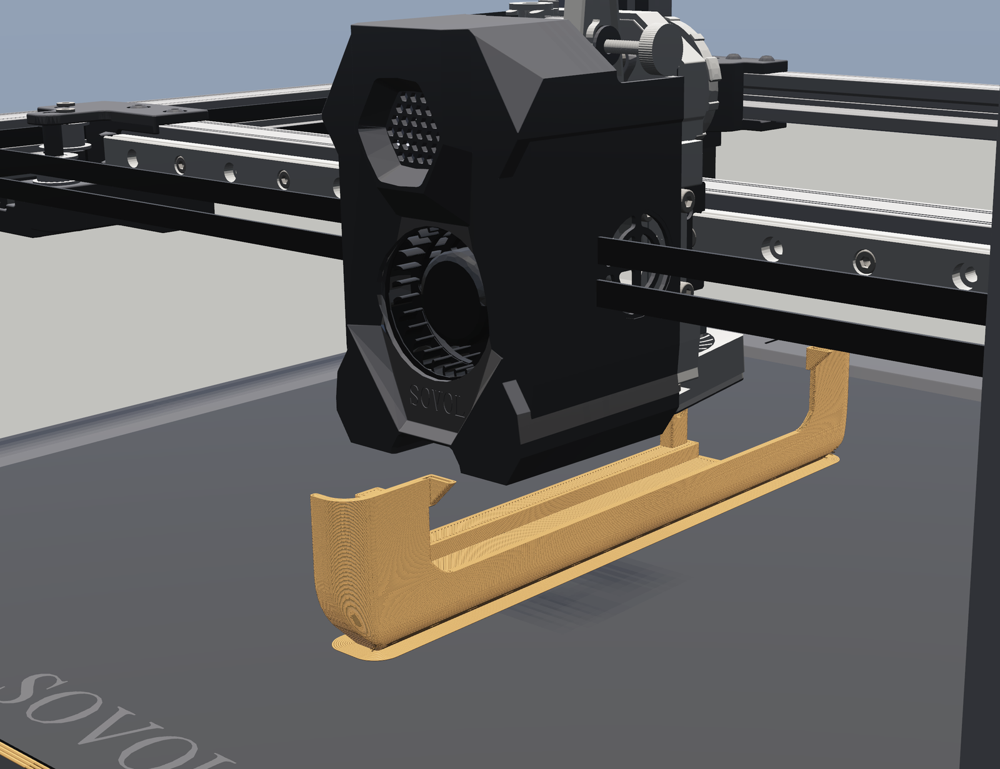

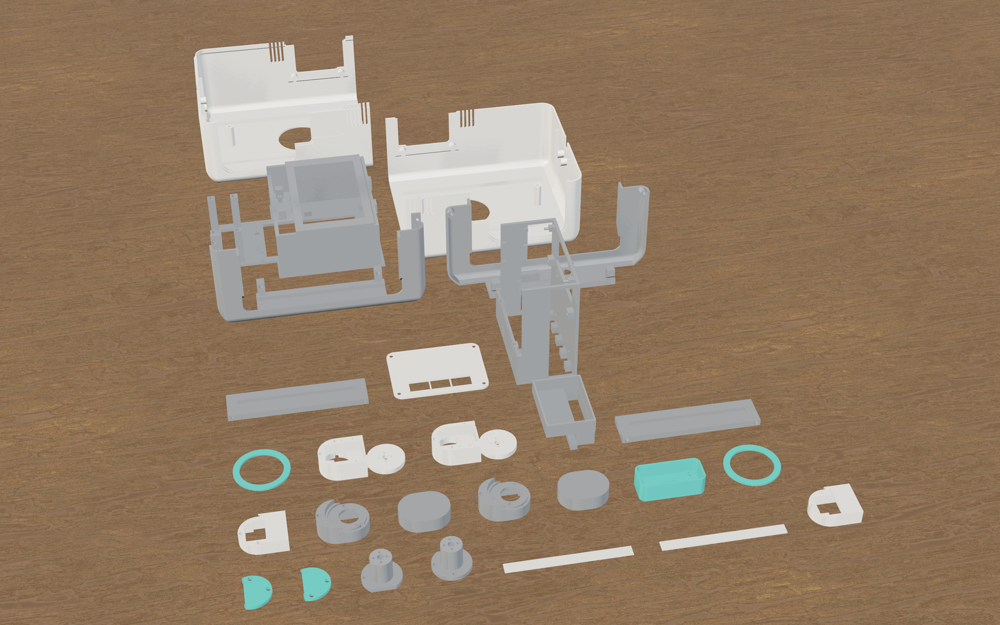

## 5. Wiring

[`harness.py`](../../projects/manufacturing/products/spark_rover/harness.py) routes every
wire of the netlist through the assembled robot in 3D, on a 1 mm grid. The netlist has 128
wires. **127 were routed** and none failed. The one left unrouted is the Pi Active
Cooler's own lead, which is wired at the factory. The cut length is **17.94 m**, against the
19.12 m estimated before routing.

The closest a wire comes to another wire is 0.31 mm. The closest a wire comes to a part is
0 mm: W10 touches one, and its route needs checking on the bench (`release/REPORT.md`).

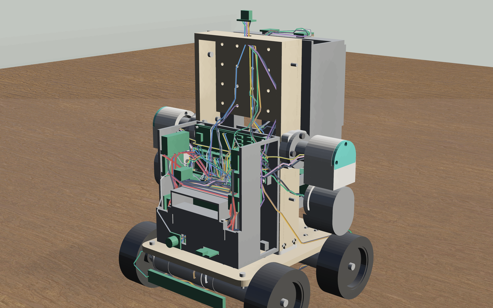

## 6. Assembly

[`assemble.py`](../../projects/manufacturing/products/spark_rover/assemble.py) builds the
robot in the design's order on Newton: **53 units in 18 steps**. Each unit is swept along
its insertion path against everything already placed, checked at its seat, then let go.
**No path was blocked, and no unit interfered at its seat.**

The exact sweep forced one change to the build. The electronics carriers are populated on
the bench, and each loaded carrier then goes onto the spine as one unit. The order of the
boards on each carrier was found by taking the populated carrier apart.

The finished robot stands on all four wheels: 0.0° of tilt, with its centre of mass
103.15 mm up against 103.18 designed (`release/assembly/assembly_log.json`). The screws are
placed, not simulated. The 34 units held only by their screws move when let go, and
[ASSEMBLY.md](../../projects/manufacturing/products/spark_rover/release/ASSEMBLY.md) says so.

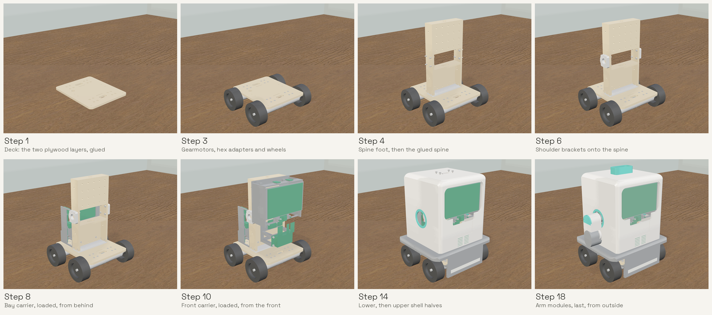

## 7. It drives

[`robot.py`](../../projects/manufacturing/products/spark_rover/robot.py) builds the robot
from the design, with every part's mass and inertia. Its controller drives 1 m straight,
stops, spins in place and waves both arms through every limit. The motors run on the
battery model's bus voltage at every step. The head's camera and screen are working
devices: the screen draws a face, with the camera's latest frame in its corner.

These results are from `release/drive/drive_mu1.json`: Newton at a 2 ms step, MuJoCo CPU
solver, floor friction 1, from a full charge.

- Straight speed **0.694 m/s at 8.18 V** mean on the bus. The no-load prediction at that
  voltage is 0.696 m/s. Heading drift over the metre was 0°.
- The pack's current peaked at 15.7 A, and the bus never dropped below 7.43 V.
- The arms settled within 0.183° of every commanded pose.
- The spin, 4.843 rad/s, and the 47.669 mm stop depend on an engine constant, the
  wheel-armature ratio. They are not a prediction of a real robot (`release/REPORT.md`).

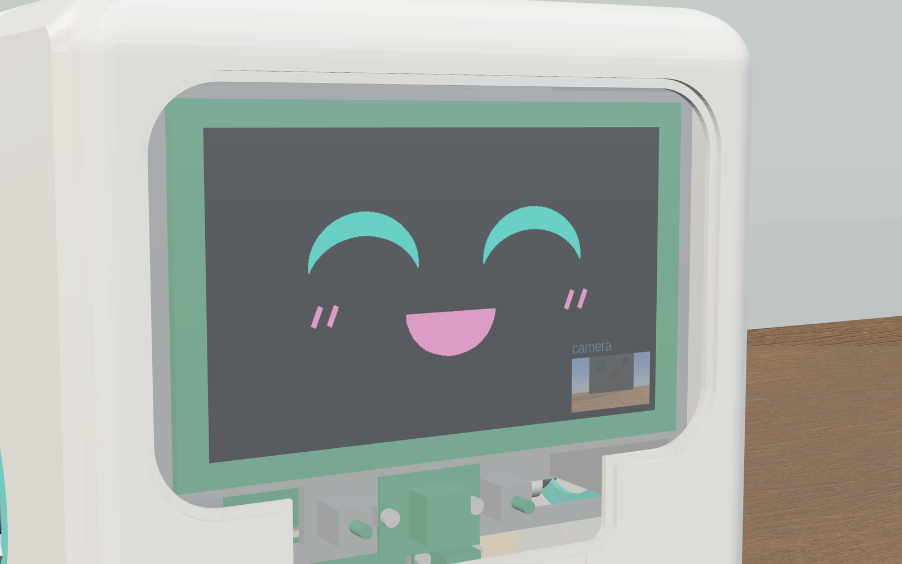

## 8. The release pack

[`release/`](../../projects/manufacturing/products/spark_rover/release/) holds what someone
would take to real machines:

- **Drawings:** 38 SVGs, one per made part, with every hole tabled.
- **Models:** 38 STLs, in mm.
- **Machine files:** 10 laser and CNC programs the twins ran, and the print plates' G-code
  with the SV08 material profiles.
- **BOM:** made and bought parts with masses and sources, the wire cut list and the stock.
  It adds up to 2397.8 g.
- **Assembly guide:** the 18 steps, with a picture and the screws for every step.
- The schematic, the wiring list, the power budget and the full report.

`python release.py` regenerates the whole folder from the modules and the result files.

## 9. What is not done

These items are open, as REPORT.md and the README list them:

- **Nothing has been made for real.** No part has been made on a real machine, and no twin
  has been validated against its machine.
- **25 printed parts' current results are ideal-mode**: their full-twin runs on the fixed
  bead rule were still running at this release; the earlier twin runs are kept, labelled.
- **The bead model was corrected during this work, and the full twin prints are being
  re-run.** The engine used to treat a creeping nozzle as standing still, and laid the plastic
  it held as one bead up to about 7 mm wide, or as a dome the nozzle later counted as a crash.
  Fixed, the ideal prints show no crashes and small parts' footprints shrink (an upper arm's
  from +1.556 to +0.161 mm). The twin rows measured before the fix are labelled so in PRINT.md.
- **The front carrier needs about 64 g of support** to print a 75 g part.
- **Some board hole positions are assumed** on U5, U6, U12 and U11. Check them against the
  boards before printing the carriers.
- **The XC330 servo horn's dimensions are unverified.** They are scaled from ROBOTIS's
  figures.
- **The mass margin is 2.2 g** against the 2400 g ceiling, on the design's masses.
- **One wire, W10, reads 0 mm** of clearance to a part.
- **The spin and stop figures depend on the engine's wheel armature.**
- **The acrylic face cover has no cutting-load model.**
- **The engine's 1984-cell stock cap** is worked around with windows, not lifted.
- **The shell lists 15 changes** it would make to the skeleton.
- **Not everything in the face is simulated.** The microphones are not simulated, and
  neither are the speaker, the touch pads or the status LEDs. The screen is lit by the scene
  rather than glowing.

## 10. Reproduce it

From the
[SparkRover README](../../projects/manufacturing/products/spark_rover/README.md#reproduce).
First install the Python packages the design scripts import, and check every stage. `setup`
shows what pip will install and asks first. The slicing stages also need UltiMaker Cura,
which `setup` does not download (see
[Before you start](manufacturing-make-your-own-product.md#before-you-start)).

```bash
python -m omnisim manufacturing setup      # from the repository root, once
python -m omnisim manufacturing doctor     # per stage: can it run here, and what is missing
cd projects/manufacturing/products/spark_rover
python skeleton.py                  # the contract's own checks
python integrate.py                 # zones, interference, interfaces, mass (a few minutes)
python harness.py                   # route every wire
python make.py --process laser --process cnc     # the laser and CNC twins, headless (about an hour)
python make_print.py --run          # the SV08 twin, plate by plate (hours)
python robot.py --quit --result <path>.json      # the drive-test world, then:
python -m omnisim run-headless projects/samples/demos/worlds/manufacturing/spark_rover_drive_test.omniworld --duration 60
python assemble.py                  # the assembly on Newton (about half an hour)
python release.py                   # regenerate release/
```

The facts on this page are listed, with their source files, in
[`manufacturing-concept-to-robot.facts.json`](manufacturing-concept-to-robot.facts.json).
`tests/test_manufacturing_story_facts.py` re-reads every source and fails if any number has
changed.
