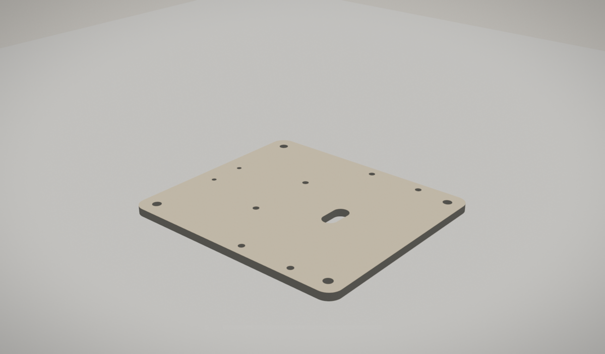
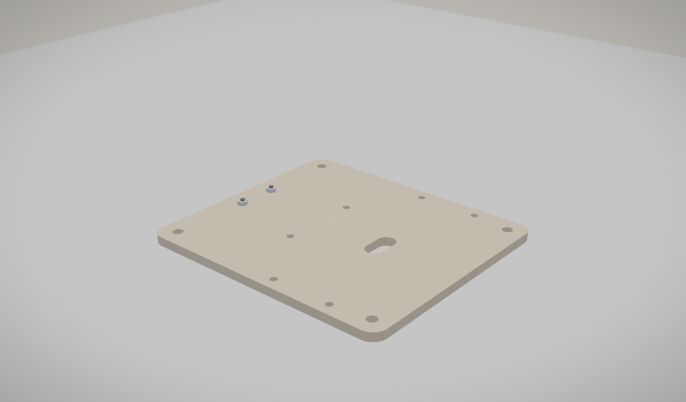
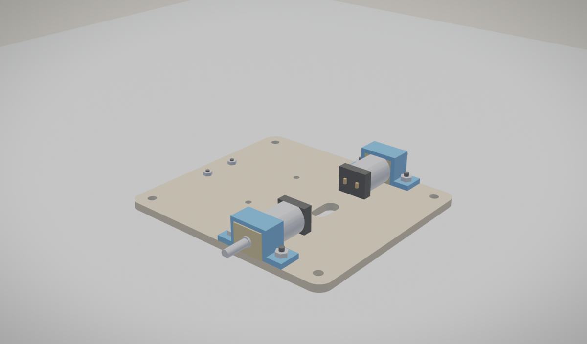
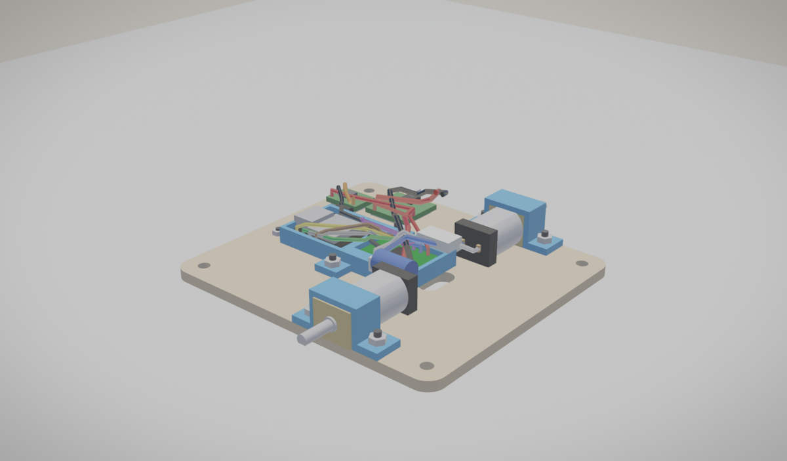
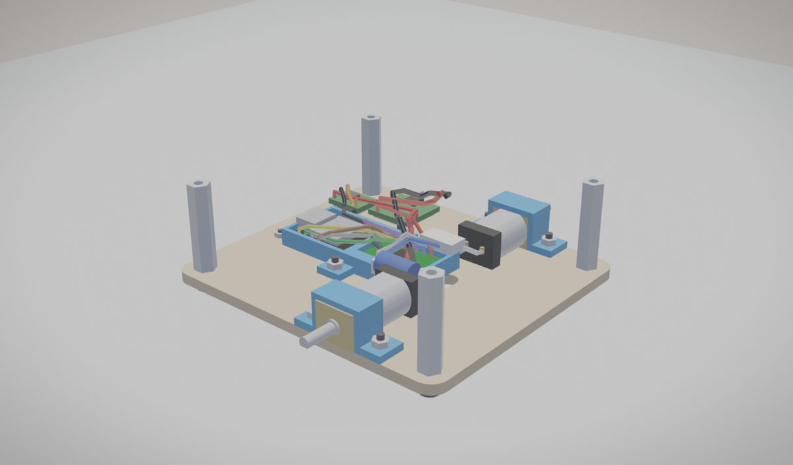
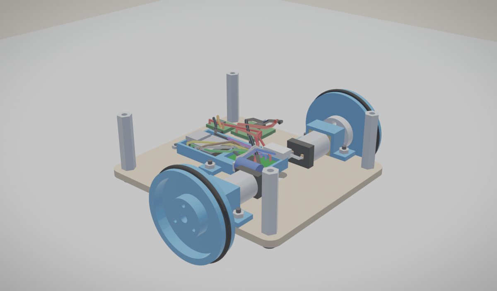
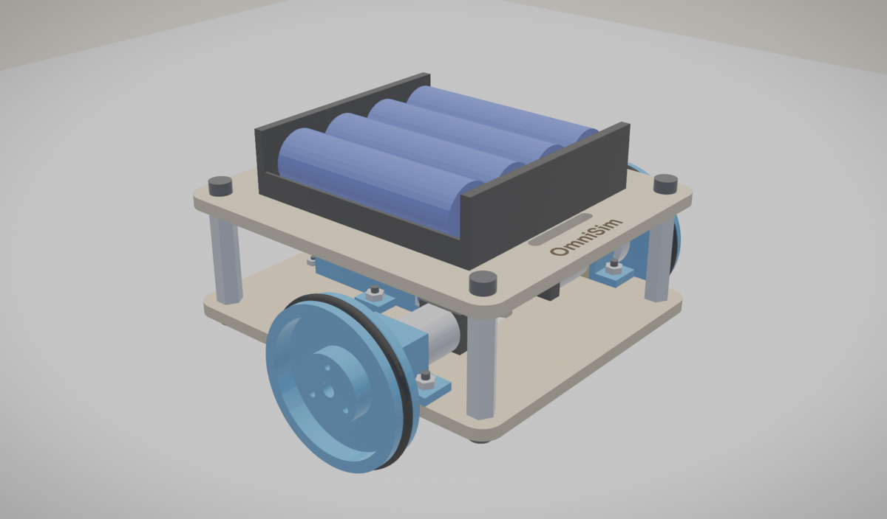

# Desk robot: assembly

Tools: 1.5 and 2.5 mm hex keys, small pliers for the M2 nuts. Parts: see [BOM.md](BOM.md). Drawings: [drawings/](drawings/).

## 1. The bottom plate

Lay the bottom plate flat. Its front is the end with the slot (the motors go over it); the two holes on the centre line at the back take the caster.

- Check the 13 holes are clear: the M2 holes take an M2 screw, the M3 holes an M3.

## 2. The caster, under the plate

Fit the Pololu ball caster UNDER the plate at its two M2 holes near the back (X -33), with its 1/16 in spacer between caster and plate. M2 x 6 screws from above, nuts below.

- Caster plus spacer stands 11.658 mm: the plate's underside sits 11.66 mm up on the wheels, so the robot stands level (0.003 mm).

## 3. The motors, in their clamps

Lay each gearmotor on the plate, shaft outward, its gearbox face 0.5 mm past the plate's side edge, and press its clamp over the gearbox. Two M2 x 6 screws through the clamp's tabs and the plate, nuts below.

- The clamp's channel is 12.1 x 10.1 mm over a 12 x 10 mm gearbox: snug, not forced.

## 4. The electronics tray

Seat the XIAO ESP32-S3 and the DRV8833 carrier in their pockets, then screw the tray down at its two tabs (M2 x 6, nuts below). Feed the motor leads up through the slot between the motors.

- Motors to the driver's AOUT1/2 and BOUT1/2; driver inputs to four XIAO GPIOs; VM and GND to the battery.

## 5. The standoffs

Four M3 x 25 mm standoffs on the bottom plate's corner holes, M3 x 6 screws from below.

## 6. The wheels: hub, rim, tyre

Screw each aluminium hub to its printed rim with three M2 x 8 screws (they cut their own thread in the rim's 1.7 mm holes). Roll the 34 x 2 mm O-ring into the rim's groove. Press the wheel onto the motor's D-shaft, hub first, until the hub stands 1 mm off the gearbox face.

- The tyre stretches 4.12 % (Parker's limit 5 %) and the wheel comes to 39.32 mm.
- The shaft ends 3.4 mm inside the rim, clear of its bore by 0.2 mm.

## 7. The top plate and the battery

Screw the top plate onto the standoffs (M3 x 6), engraving up, the name to the front. Strap the 4 x AA holder on with the hook-and-loop strap through the two slots; its leads go down through the hole at the front left.

- Track 100.8 mm, top speed with no load 0.679 m/s.
