# SparkRover Mini: assembly

Generated by `release.py` from `assemble.py`'s build order and its run on Newton (`release/assembly/assembly_log.json`); do not hand-edit. The order is the design's: "shoulder brackets onto the spine first; then the shell and the electronics; each arm module (post, servos, links: assembled on the bench) goes on LAST, from outside: the post through the 40 mm opening, its two M3 screws driven through the arm's access bores with a 2.5 mm hex driver" (skeleton.ASSEMBLY_NOTE). Parts: [BOM.md](BOM.md); drawings: [drawings/](drawings/); the wiring: [electrical/](electrical/).

Each step's picture is the twin's, at the end of the step. Under each unit, what the engine saw when it was let go at its seat: **rests** (it stays within the 0.2 mm screw clearance), **shifts** (within 2 mm) or **held by its screws** (it moves further without them: the screws are not simulated, they are placed at their seats). Bench steps are done off the robot: the carrier is populated on the bench and goes on as one unit.

## 1. Deck: the two plywood layers, glued

*chassis step 1*

- **deck_lower** (deck_lower): in from above (+z), 20 mm. On Newton: rests.
- **deck_upper** (deck_upper): in from above (+z), 20 mm. On Newton: rests.

Fasteners at their seats (FCL): 0 threaded, 0 touching, 0 interfering.

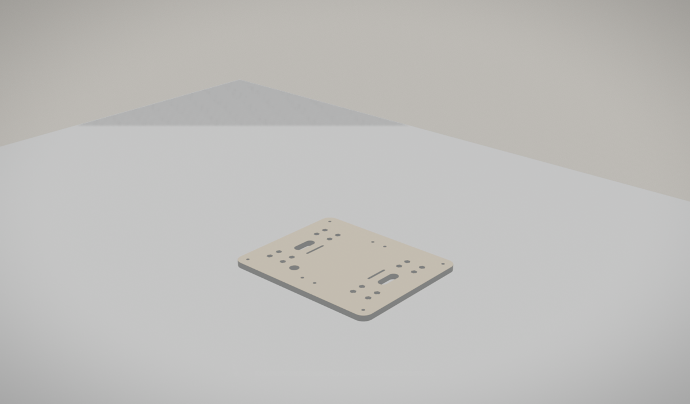

## 2. Gearmotors into their brackets (bench), then each unit on its spacer under the deck

*chassis steps 2-3*

- **spacer_fl** (spacer_fl): in from below (-z), 20 mm. On Newton: held by its screws.
- **motor_unit_fl** (bracket_fl, motor_fl, motor_fl_shaft): in from below (-z), 20 mm. On Newton: held by its screws. Gearmotor and bracket joined on the bench, offered up from below.
- **spacer_fr** (spacer_fr): in from below (-z), 20 mm. On Newton: held by its screws.
- **motor_unit_fr** (bracket_fr, motor_fr, motor_fr_shaft): in from below (-z), 20 mm. On Newton: held by its screws. Gearmotor and bracket joined on the bench, offered up from below.
- **spacer_rl** (spacer_rl): in from below (-z), 20 mm. On Newton: held by its screws.
- **motor_unit_rl** (bracket_rl, motor_rl, motor_rl_shaft): in from below (-z), 20 mm. On Newton: held by its screws. Gearmotor and bracket joined on the bench, offered up from below.
- **spacer_rr** (spacer_rr): in from below (-z), 20 mm. On Newton: held by its screws.
- **motor_unit_rr** (bracket_rr, motor_rr, motor_rr_shaft): in from below (-z), 20 mm. On Newton: held by its screws. Gearmotor and bracket joined on the bench, offered up from below.

Fasteners in this step:

- 8 x M3 x 8 ISO 7380
- 8 x M3 washer ISO 7089
- 16 x M3 x 12 ISO 7380
- 16 x M3 nut ISO 4032

Fasteners at their seats (FCL): 8 threaded, 40 touching, 0 interfering.

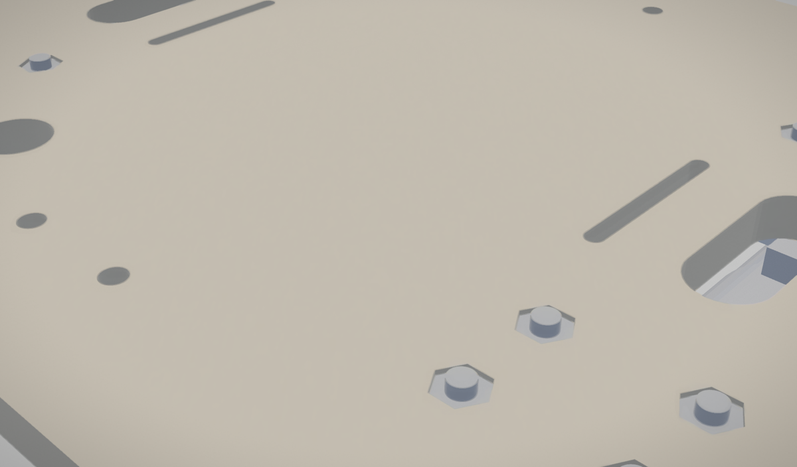

## 3. Hex adapters and wheels

*chassis step 4*

- **hex_adapter_fl** (hex_adapter_fl): in from the left (+y), 12 mm. On Newton: rests.
- **wheel_fl** (wheel_fl): in from the left (+y), 30 mm. On Newton: rests.
- **hex_adapter_fr** (hex_adapter_fr): in from the right (-y), 12 mm. On Newton: rests.
- **wheel_fr** (wheel_fr): in from the right (-y), 30 mm. On Newton: rests.
- **hex_adapter_rl** (hex_adapter_rl): in from the left (+y), 12 mm. On Newton: rests.
- **wheel_rl** (wheel_rl): in from the left (+y), 30 mm. On Newton: rests.
- **hex_adapter_rr** (hex_adapter_rr): in from the right (-y), 12 mm. On Newton: rests.
- **wheel_rr** (wheel_rr): in from the right (-y), 30 mm. On Newton: rests.

Fasteners in this step:

- 4 x M4 x 8 ISO 4762

Fasteners at their seats (FCL): 0 threaded, 4 touching, 0 interfering.

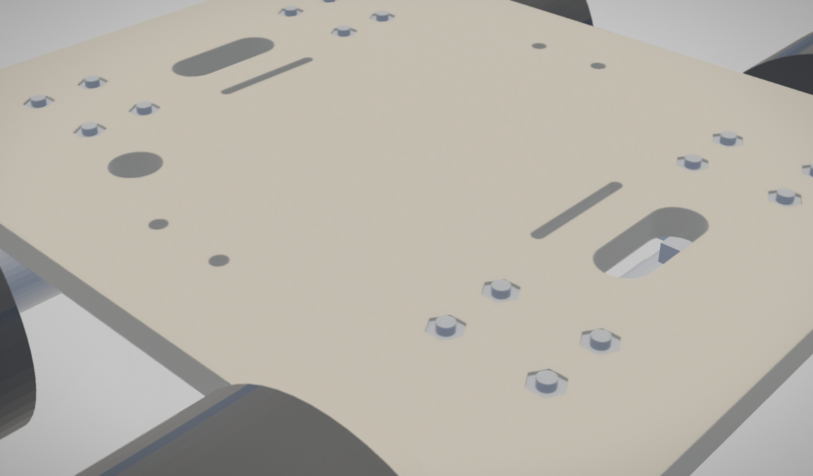

## 4. Spine foot, then the spine (its six plates glued on the bench)

*chassis steps 5-6*

- **spine_foot** (spine_foot): in from above (+z), 20 mm. On Newton: rests.
- **spine** (spine_side_l, spine_side_r, spine_rear, spine_front, spine_rung_mid, spine_rung_top): in from above (+z), 30 mm. On Newton: rests. A glued box: placed whole.

Fasteners in this step:

- 4 x M3 x 16 ISO 4762
- 4 x M3 nut ISO 4032

Fasteners at their seats (FCL): 0 threaded, 8 touching, 0 interfering.

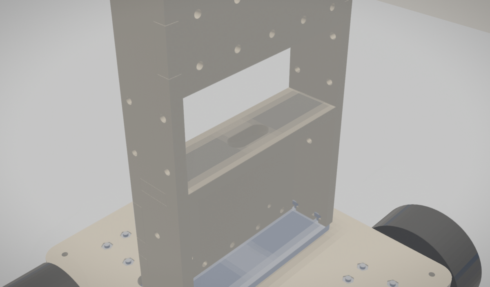

## 5. Battery under the deck, strapped

*chassis step 8, electrical step 6 (the pack)*

> electrical step 6: harness: pack, motors, encoders, servo plugs, FPCs, all before shell step 2; then the shell-mounted parts' leads as their sections go on: the LED strips', charger's and button's with the lower halves (shell step 2), the touch pads' with the upper halves (shell step 4)

- **battery** (el_BT1): in from below (-z), 30 mm. On Newton: held by its screws.

Also in this step: battery_strap.

Fasteners at their seats (FCL): 0 threaded, 0 touching, 0 interfering.

## 6. Shoulder brackets onto the spine

*skeleton.ASSEMBLY_NOTE, arms step 1*

- **shoulder_bracket_left** (shoulder_bracket_left): in from the left (+y), 20 mm. On Newton: held by its screws.
- **shoulder_bracket_right** (shoulder_bracket_right): in from the right (-y), 20 mm. On Newton: held by its screws.

Fasteners in this step:

- 8 x M3 x 12 ISO 4762 (interface screw, see interface_joints)

Fasteners at their seats (FCL): 8 threaded, 8 touching, 0 interfering.

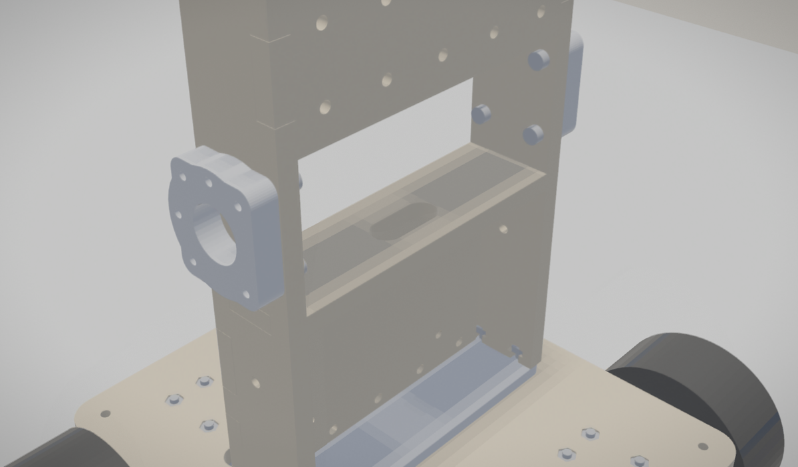

## 7. Bench: populate the bay carrier (bench)

*electrical steps 1-3, on the bench*

> electrical step 1: bench, the bay carrier (its inserts heat-set): the Pi on its standoffs with its Active Cooler, as one unit, slid in sideways from the left (+y); it sits loose until step 3's screws hold its standoffs
> electrical step 2: bench, the bay carrier's power: the regulators (2 x M2 x 5 each) and the Motorons lowered in from above, the switch, fuse and the WAGO hubs X1-X3 in from behind (-x), X4 from above
> electrical step 3: bench: the IO board (Pico, logic ICs, headers: populated first) lowered from above, the last 5 mm forward onto its hooks, 2 x M2.5 x 6 into the lower inserts; then the cooler duct from above (2 x M2 x 10 into the lip's inserts). Then the loaded bay carrier onto the spine from behind (-x), after the shoulder brackets: 5 x M3 x 12 from inside the spine into its inserts, then the chassis's 4 x M2.5 x 16 from inside the spine through the carrier into the Pi's standoffs

On the bench, onto **el_bay_carrier** with its 9 heat-set inserts, in this order (found by taking the populated carrier apart): pi_unit, el_U5, el_U6, el_SW1, el_MA, el_MB, el_F1, el_X1, el_X2, el_X3, el_X4, io_board, el_cooler_duct.

- **pi_unit** (el_U1, el_pi_standoffs, el_U10): in from the left (+y), 88 mm (the way out found by taking the populated carrier apart). On Newton: held by its screws. The Pi on its standoffs with its Active Cooler, as one unit.
- **el_U5** (el_U5): in from above (+z), 100 mm (the way out found by taking the populated carrier apart). On Newton: held by its screws.
- **el_U6** (el_U6): in from above (+z), 85.5 mm (the way out found by taking the populated carrier apart). On Newton: held by its screws.
- **el_SW1** (el_SW1): in from behind (-x), 33 mm (the way out found by taking the populated carrier apart). On Newton: held by its screws.
- **el_MA** (el_MA): in from above (+z), 100 mm (the way out found by taking the populated carrier apart). On Newton: held by its screws.
- **el_MB** (el_MB): in from above (+z), 87.5 mm (the way out found by taking the populated carrier apart). On Newton: held by its screws.
- **el_F1** (el_F1): in from behind (-x), 41.5 mm (the way out found by taking the populated carrier apart). On Newton: held by its screws.
- **el_X1** (el_X1): in from behind (-x), 26.5 mm (the way out found by taking the populated carrier apart). On Newton: held by its screws.
- **el_X2** (el_X2): in from behind (-x), 37.5 mm (the way out found by taking the populated carrier apart). On Newton: held by its screws.
- **el_X3** (el_X3): in from behind (-x), 37.5 mm (the way out found by taking the populated carrier apart). On Newton: held by its screws.
- **el_X4** (el_X4): in from above (+z), 100 mm (the way out found by taking the populated carrier apart). On Newton: held by its screws.
- **io_board** (el_B1, el_U2, el_U3, el_U4, el_U7): in from above (+z), 46.5 mm, then from behind (-x), 5 mm (the way out found by taking the populated carrier apart). On Newton: held by its screws. IO board populated first (Pico, logic ICs, headers).
- **el_cooler_duct** (el_cooler_duct): in from above (+z), 100 mm (the way out found by taking the populated carrier apart). On Newton: shifts 0.249 mm.

Fasteners in this step:

- 2 x M2.5 x 6 ISO 4762 into an RX-M2.5x5.7 in the IO board's lower boss
- 4 x M2 x 5 ISO 4762 into a 1.7 mm pilot in its boss and the wall behind
- 2 x M2 x 10 ISO 4762 into an RX-M2x4 in the rear lip's pad
- 1 set of 4 x M2.5 x 12 mm brass hex standoff, female-female, 5 mm across flats, tapped M2.5 through (ASSUMED generic)
- 5 x ruthex RX-M3x5.7 brass heat-set insert (OD 4.6, 5.7 long)
- 2 x ruthex RX-M2.5x5.7 brass heat-set insert (OD 4.6, 5.7 long)
- 2 x ruthex RX-M2x4 brass heat-set insert (OD 3.6, 4.0 long)

Also in this step: el_C2, el_C4, el_C5, el_C6, el_R3, el_R4, el_R5, el_R6, el_R7, el_R11, el_D5, el_F2, el_F3, el_JE1, el_JM1, el_JE2, el_JM2, el_JE3, el_JM3, el_JE4, el_JM4.

Fasteners at their seats (FCL): 0 threaded, 24 touching, 0 interfering.

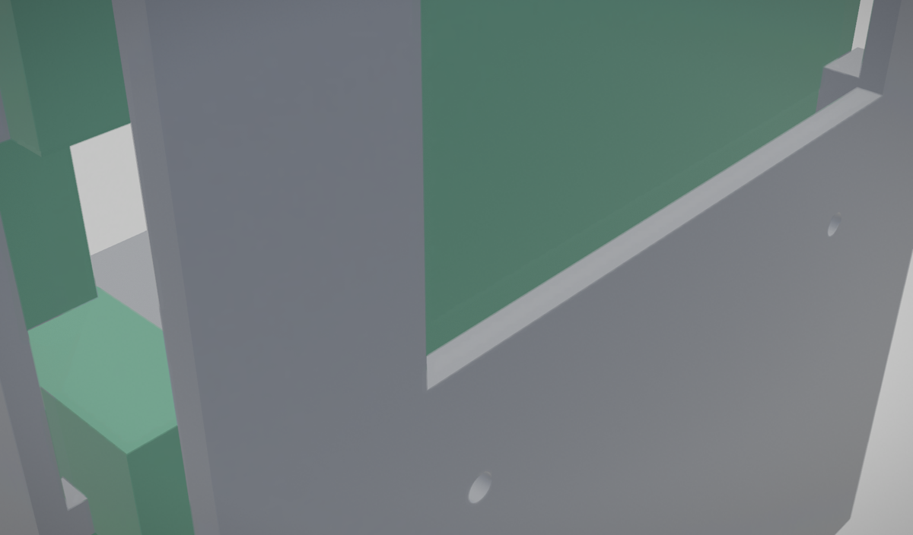

## 8. The bay carrier, loaded, onto the spine from behind (-x); its screws from inside the spine

*electrical step 3*

> electrical step 3: bench: the IO board (Pico, logic ICs, headers: populated first) lowered from above, the last 5 mm forward onto its hooks, 2 x M2.5 x 6 into the lower inserts; then the cooler duct from above (2 x M2 x 10 into the lip's inserts). Then the loaded bay carrier onto the spine from behind (-x), after the shoulder brackets: 5 x M3 x 12 from inside the spine into its inserts, then the chassis's 4 x M2.5 x 16 from inside the spine through the carrier into the Pi's standoffs

- **bay_carrier_loaded** (58 parts): in from behind (-x), 20 mm. On Newton: held by its screws. The populated carrier as one unit.

Fasteners in this step:

- 5 x M3 x 12 ISO 4762 into an RX-M3x5.7 in the bay carrier's boss
- 4 x M2.5 x 16 ISO 4762 (interface screw, see interface_joints)

Fasteners at their seats (FCL): 4 threaded, 4 touching, 0 interfering.

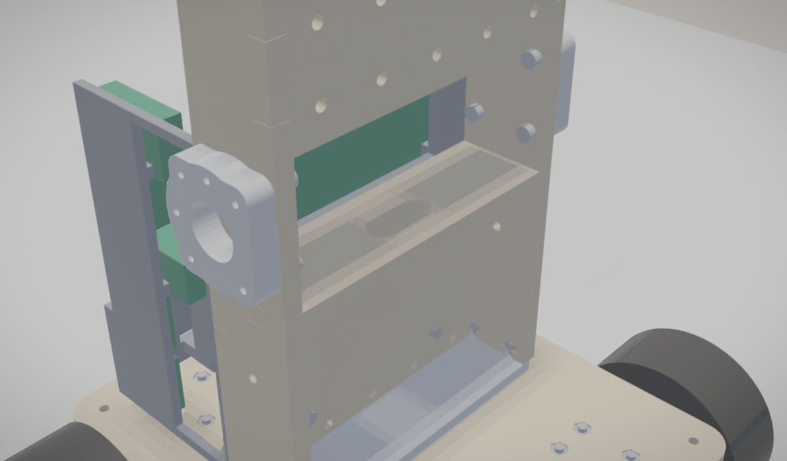

## 9. Bench: populate the front carrier (bench)

*electrical steps 4-5, on the bench*

> electrical step 4: bench, the front carrier (its inserts heat-set): display from the front and camera up from below, in either order (4 x M2 x 5), LEDs, mics
> electrical step 5: bench: the chest, from the front: speaker (4 x M3 x 8), amp and MPR121 (2 x M2 x 6 each). Then the loaded front carrier onto the spine from the front (+x): 4 x M3 x 12 from inside the spine into its inserts

On the bench, onto **el_front_carrier** with its 8 heat-set inserts, in this order (found by taking the populated carrier apart): el_U9, el_U8, el_LS1, el_U11, el_U12.

- **el_U9** (el_U9): in from below (-z), 91.5 mm (the way out found by taking the populated carrier apart). On Newton: held by its screws.
- **el_U8** (el_U8): in from the front (+x), 3.5 mm (the way out found by taking the populated carrier apart). On Newton: held by its screws.
- **el_LS1** (el_LS1): in from the front (+x), 18.5 mm (the way out found by taking the populated carrier apart). On Newton: held by its screws.
- **el_U11** (el_U11): in from the front (+x), 55.5 mm (the way out found by taking the populated carrier apart). On Newton: held by its screws.
- **el_U12** (el_U12): in from the front (+x), 55.5 mm (the way out found by taking the populated carrier apart). On Newton: held by its screws.

Fasteners in this step:

- 4 x M2 x 5 ISO 4762 into a 1.7 mm pilot in its post / boss
- 4 x M2 x 6 ISO 4762 into a 1.7 mm pilot in its post / boss
- 4 x M3 x 8 ISO 4762 into an RX-M3x5.7 at its post's end
- 8 x ruthex RX-M3x5.7 brass heat-set insert (OD 4.6, 5.7 long)

Also in this step: el_MK1, el_MK2, el_D3, el_D4, el_R8, el_R9.

Fasteners at their seats (FCL): 0 threaded, 16 touching, 0 interfering.

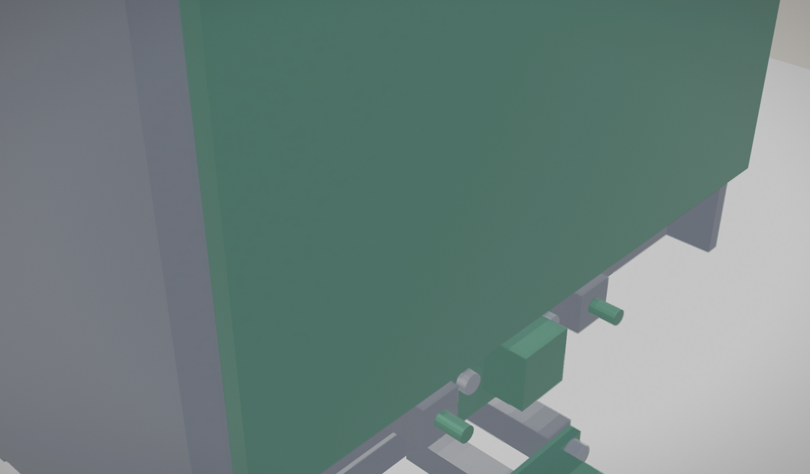

## 10. The front carrier, loaded, onto the spine from the front (+x); its screws from inside the spine

*electrical step 5*

> electrical step 5: bench: the chest, from the front: speaker (4 x M3 x 8), amp and MPR121 (2 x M2 x 6 each). Then the loaded front carrier onto the spine from the front (+x): 4 x M3 x 12 from inside the spine into its inserts

- **front_carrier_loaded** (32 parts): in from the front (+x), 20 mm. On Newton: held by its screws. The populated carrier as one unit.

Fasteners in this step:

- 4 x M3 x 12 ISO 4762 into an RX-M3x5.7 in the front carrier's grid boss

Fasteners at their seats (FCL): 0 threaded, 0 touching, 0 interfering.

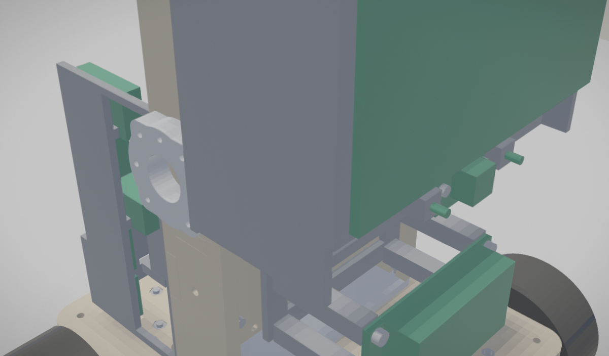

## 11. Electronics: harness: pack, motors, encoders, servo plugs, FPCs, all before shell step 2; then the shell-mounted parts' leads as their sections go on: the LED strips', charger's and button's with the lower halves (shell step 2), the touch pads' with the upper halves (shell step 4)

*electrical step 6*

> electrical step 6: harness: pack, motors, encoders, servo plugs, FPCs, all before shell step 2; then the shell-mounted parts' leads as their sections go on: the LED strips', charger's and button's with the lower halves (shell step 2), the touch pads' with the upper halves (shell step 4)

Also in this step: el_J1, el_JS1, el_JS2, el_harness.

Fasteners at their seats (FCL): 0 threaded, 0 touching, 0 interfering.

## 12. Lower shell halves, slid on along x, lugs under the deck corners

*shell steps 1-2*

> shell step 1: bench: heat-set every insert; LED strip and diffuser into each bumper, bumper onto its lower half (2 M2 x 12 from below); teal rings into the upper halves (glued)
> shell step 2: lower front and rear halves slide onto the chassis along x, their lugs under the deck corners; the four lower mount screws go in from above through the deck
> electrical step 0: bench, with shell step 1: the LED strips (D1 with C3 at its input, D2) into the bumpers' channels; the charger (CHG1) and the button board (B2 with S1, R10) screwed onto the lower rear half's M2 inserts; the touch pads taped inside the upper halves (TP1 right, TP2 and TP3 left); every one with its leads soldered on, left long

- **shell_lower_front** (7 parts): in from the front (+x), 25 mm. On Newton: held by its screws. Bench: bumper, diffuser and LED strip on, inserts in (shell step 1).
- **shell_lower_rear** (16 parts): in from behind (-x), 25 mm. On Newton: held by its screws. Bench: bumper, diffuser and LED strip on, inserts in (shell step 1).

Fasteners in this step:

- 4 x M2 x 12
- 4 x M3 x 12 ISO 4762 (interface screw, see interface_joints)
- 6 x brass heat-set insert M3 x 5.7, OD 4.6 (ruthex RX-M3x5.7 or CNC Kitchen M3 standard)
- 4 x M2 brass heat-set insert

Fasteners at their seats (FCL): 4 threaded, 8 touching, 0 interfering.

## 13. Side seam screws

*shell step 3*

> shell step 3: the two side seam screws from below, between the wheels

Fasteners in this step:

- 2 x M3 x 8

Fasteners at their seats (FCL): 0 threaded, 2 touching, 0 interfering.

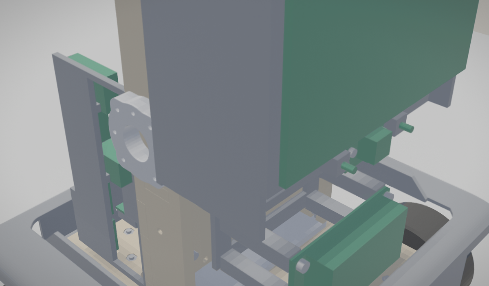

## 14. Upper shell halves, slid on along y onto the spine (left, then right)

*shell steps 1, 4*

> shell step 1: bench: heat-set every insert; LED strip and diffuser into each bumper, bumper onto its lower half (2 M2 x 12 from below); teal rings into the upper halves (glued)
> shell step 4: upper left half slides in along -y onto the spine, then the right half (its tongue inside the left); the four upper mount screws from inside the spine (the arm modules go on after step 7, last, from outside: skeleton.ASSEMBLY_NOTE)

- **shell_upper_left** (8 parts): in from the left (+y), 90 mm. On Newton: shifts 0.712 mm. Bench: teal ring glued in, inserts in.
- **shell_upper_right** (8 parts): in from the right (-y), 90 mm. On Newton: held by its screws. Bench: teal ring glued in, inserts in.

Fasteners in this step:

- 4 x M3 x 12 ISO 4762 (interface screw, see interface_joints)
- 12 x brass heat-set insert M3 x 5.7, OD 4.6 (ruthex RX-M3x5.7 or CNC Kitchen M3 standard)

Also in this step: el_TP1, el_TP2, el_TP3.

Fasteners at their seats (FCL): 4 threaded, 7 touching, 0 interfering.

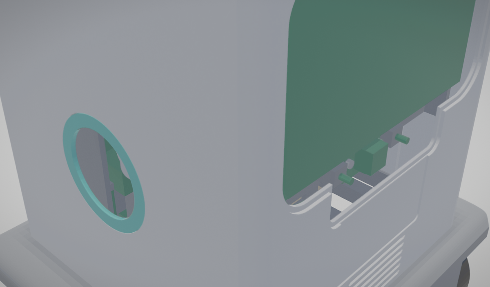

## 15. Top slot socket, then the accessory board

*shell step 5, electrical step 7*

> shell step 5: top slot socket: 4 M3 x 8 into the halves' inserts (clamps the seam at the top)
> electrical step 7: accessory board on the top socket's floor (VHB), its wires up through the floor's slot: with shell step 5

- **top_socket** (top_socket): in from above (+z), 20 mm. On Newton: shifts 0.492 mm.
- **el_B3** (el_B3): in from above (+z), 15 mm. On Newton: rests.

Fasteners in this step:

- 4 x M3 x 8

Also in this step: el_J_TOP.

Fasteners at their seats (FCL): 0 threaded, 4 touching, 0 interfering.

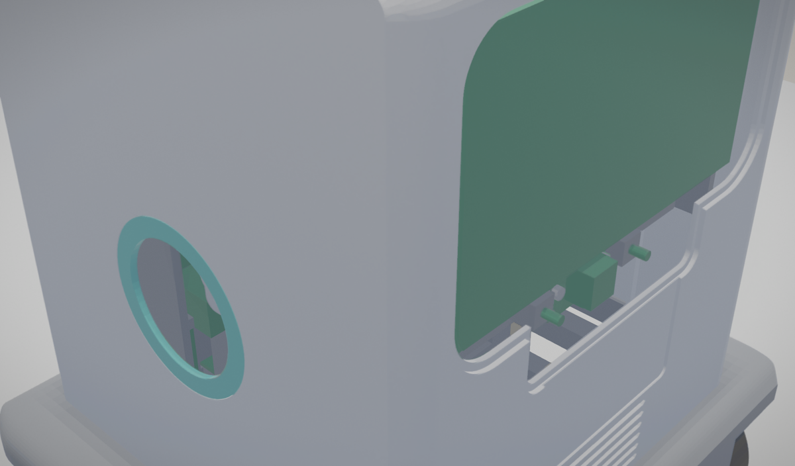

## 16. Rear hatch

*shell step 6*

> shell step 6: rear hatch: 4 M3 x 8 countersunk (clamps the seam at the back)

- **rear_hatch** (rear_hatch): in from behind (-x), 15 mm. On Newton: shifts 1.256 mm.

Fasteners in this step:

- 4 x M3 x 8

Fasteners at their seats (FCL): 0 threaded, 0 touching, 0 interfering.

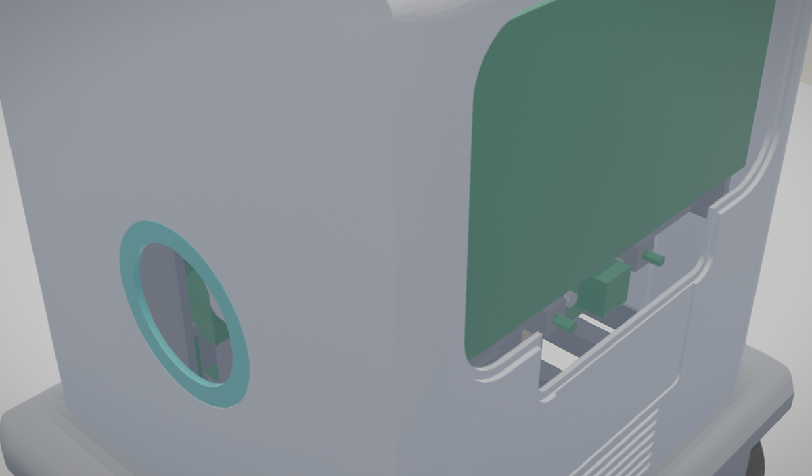

## 17. Face cover, bonded

*shell step 7*

> shell step 7: face cover bonded into its rebate (clear silicone or acrylic-safe adhesive), across the seam

- **face_cover** (face_cover): in from the front (+x), 10 mm. On Newton: held by its screws.

Fasteners at their seats (FCL): 0 threaded, 0 touching, 0 interfering.

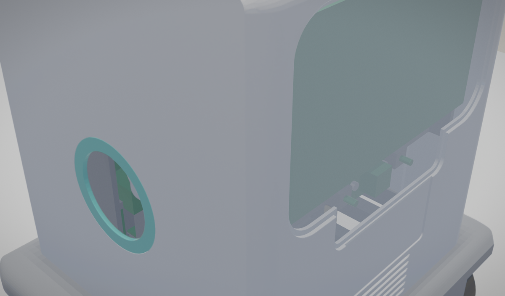

## 18. Arm modules, last, from outside

*skeleton.ASSEMBLY_NOTE, arms steps 2-5*

- **arm_left** (25 parts): in from the left (+y), 30 mm. On Newton: shifts 0.407 mm. The arm module (post, servos, links, screws), built on the bench; post through the 40 mm opening.
- **arm_right** (25 parts): in from the right (-y), 30 mm. On Newton: shifts 0.396 mm. The arm module (post, servos, links, screws), built on the bench; post through the 40 mm opening.

Fasteners in this step:

- 4 x M3 x 10 ISO 4762 socket head cap screw
- 16 x M2 x 6 PHS tapping (ROBOTIS)
- 8 x M2 x 25 ISO 4762 socket head cap screw
- 2 x M2 x 16 ISO 4762 socket head cap screw

Fasteners at their seats (FCL): 0 threaded, 0 touching, 0 interfering.

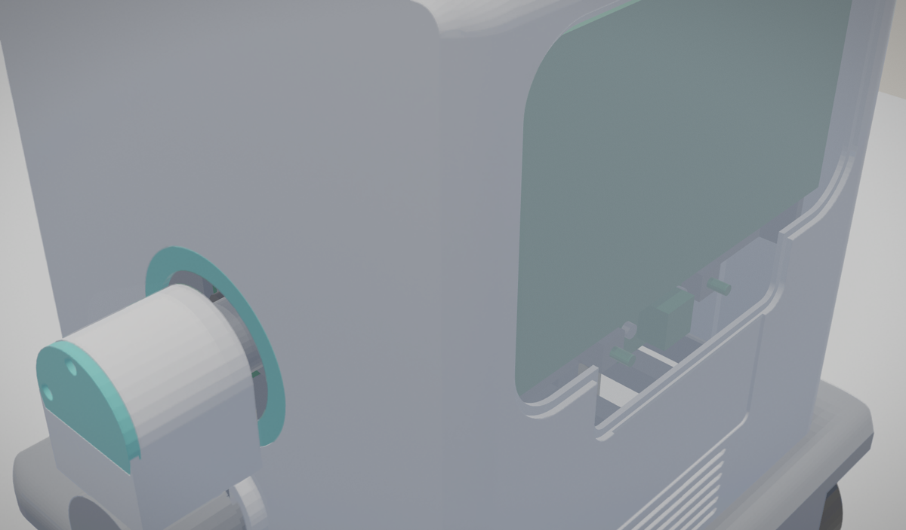

## Finished: on the bench

Stood on its four braked wheels as one body: contacts by wheel {'fl': 4, 'fr': 4, 'rl': 4, 'rr': 4}, other contacts 0, tilt 0.0 deg, drift 0.0 mm; centre of mass 103.15 mm up (designed 103.18). Pass.

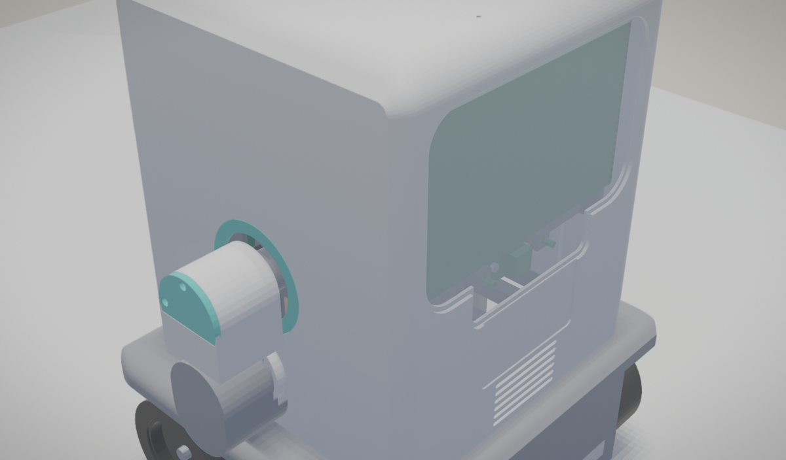
